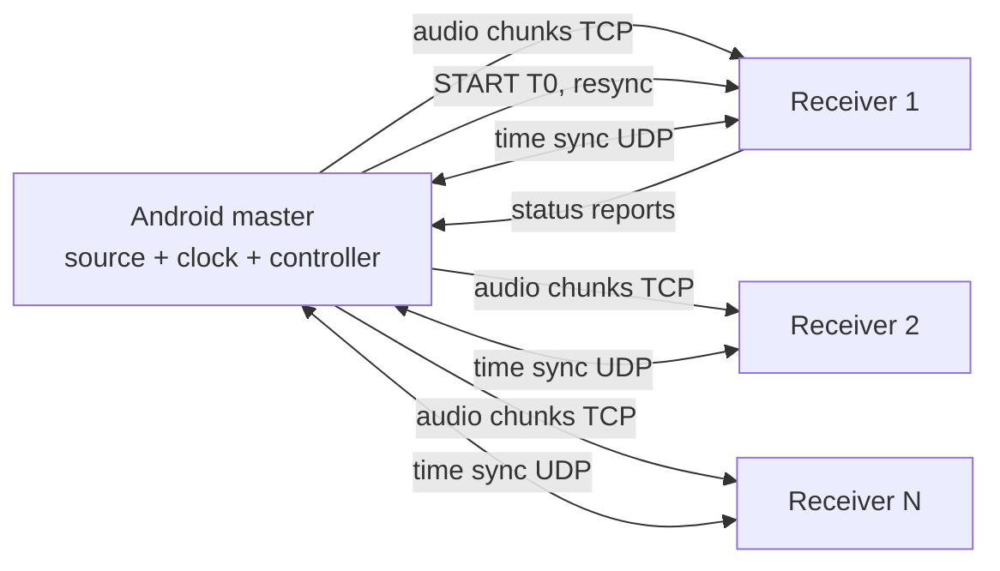

# Sync In It

<p align="center">
  
</p>

> Turn 6-10 phones (Android + iOS) into one synchronized speaker group, fully offline.

**Sync In It** is an offline, master-clock-based audio distribution system. One Android phone plays the role of audio source and master clock. Up to 10 other phones, Android or iOS, play the same audio in sync over a private local Wi-Fi network. It is designed for a single train coach (for example a Bandra-Delhi journey), with no internet, no cloud, and no dedicated speakers.

*Sync In It is a working name. Rename it freely.*

---

## Status

**Design phase. No code is released yet.** This README describes the planned system. Commands and folders marked *(planned)* do not exist yet. The full design lives in the system design document and is summarized below.

| Milestone | Description | State |
|---|---|---|
| M0 | Python simulator for time sync and drift control | Planned |
| M1 | Time sync between two real phones | Planned |
| M2 | Scheduled click-track start on 2 receivers | Planned |
| M3 | Output-timestamp mapping and manual offsets | Planned |
| M4 | Drift controller, 30-minute run | Planned |
| M5 | 3-4 receivers, group deadline, reconnect | Planned |
| M6 | Opus codec, system audio capture | Planned |
| M7 | iOS receiver | Planned |
| M8 | Acoustic calibration | Planned |
| M9 | 6-10 receivers and train trial | Planned |

---

## Why this is hard

Phones that receive identical audio still play it at different times. Each phone has its own audio clock, operating-system scheduling, output pipeline, and speaker. Starting playback when packets arrive produces echoes and drift.

Sync In It does not play audio on arrival. It gives every sample a target presentation time on a shared timeline and makes each phone hit that time. A deliberate group delay of 2-10 seconds provides the preparation time.

---

## How it works



Seven layers, each using the best-known technique:

| Layer | Job | Technique |
|---|---|---|
| L1 Transport | Deliver audio early | Timestamped chunks, deep buffer, TCP (Snapcast-style) |
| L2 Clock distribution | Shared notion of time | Lowest-RTT NTP-style exchange; optional RBS refinement |
| L3 Group playout control | One common deadline | IDMS-style reports and common target playout point (RFC 7272) |
| L4 DAC clock mapping | Master time to real output time | Platform output timestamps plus skew fit |
| L5 Drift correction | Hold alignment for hours | Sample drop/duplicate, gentle rate adjustment |
| L6 Acoustic alignment | Align sound in the air | Microphone chirp calibration; optional ultrasonic beacon |
| L7 Resilience | Survive a train | Quarantine, rejoin, adaptive delay |

### The core idea in four lines

```
M = local + theta                       # master time from local clock
T(n) = T0 + n / 48000                   # when stream sample n must be heard
n_expected(p) = ((M(p) + c_i) - T0) * 48000   # sample that frame p must carry
error e = n_expected - n_actual         # drift controller drives e to zero
```

`T0` is one start deadline for the whole group, set by the slowest receiver. `c_i` is a per-device compensation from calibration.

---

## Features (target)

- Fully offline operation over a local router
- Android master, Android and iOS receivers, one shared protocol
- Configurable group delay up to 10 seconds
- Continuous clock-offset and clock-skew estimation
- Automatic drift correction by sample drop/duplicate
- Receiver reconnect and resynchronization without disturbing others
- Manual per-device offset slider
- Microphone-based acoustic calibration at one listening position
- Per-device telemetry logs for debugging

---

## Synchronization targets

These are goals to be validated by measurement, not guarantees.

| Tier | Skew between phones | Meaning |
|---|---|---|
| T1 | 20 ms or less | Heard as a single sound source by most listeners |
| T2 | 10 ms or less | Solid result for mixed phones over Wi-Fi |
| T3 | 5 ms or less at the listening position | Stretch goal, needs calibration |

Results are reported as mean, maximum and 95th-percentile error. A literal zero-millisecond difference across different phones is not physically guaranteed.

---

## What you need

**Hardware**

- 1 Android phone for the master (Android 10+ for system audio capture)
- 2-10 receiver phones (Android and/or iOS)
- 1 portable dual-band Wi-Fi router (a phone hotspot works for early prototypes only)
- For iOS receivers: a Mac, Xcode, and physical iPhones
- For measurement: a laptop or third phone as a recorder

**Network**

- 5 GHz preferred, 2.4 GHz fallback
- Client isolation must be **off**
- No internet connection needed

---

## Quickstart *(planned)*

> These steps describe the intended workflow. They will work once milestones M1-M5 land.

1. **Set up the network.** Power the router, disable client isolation, connect all phones to it.
2. **Install the apps.** Install the master app on the Android source phone and the receiver app on every receiver.
3. **Start a session.** On the master, tap *Start session*. A QR code appears.
4. **Join receivers.** Scan the QR code on each receiver.
5. **Wait for READY.** The master shows each receiver's buffer and offset status.
6. **Play.** Choose a local audio file (or, in a later milestone, capture system audio) and press *Play*. All phones start at the common deadline.
7. **Calibrate (optional).** Place the master's microphone at your listening position and run *Calibrate*.

---

## Planned repository layout

```
Sync In It/
  core/            # portable C++: time estimator, timeline, drift controller, group deadline
  android/
    master/        # Kotlin app: session, capture, controller
    receiver/      # Kotlin + Oboe receiver
  ios/
    receiver/      # Swift + AVAudioEngine receiver
  protocol/        # wire format spec and test vectors
  sim/             # Python simulator for clocks, jitter, loss
  tools/
    analyze/       # click-track recording analysis (cross-correlation)
    logs/          # telemetry plotting
  docs/            # system design document, test reports
```

The `core/` library is shared by Android and iOS so the timing logic is identical on every platform.

---

## Protocol summary

| Channel | Transport | Content |
|---|---|---|
| Control | TCP (`TCP_NODELAY`) | HELLO, READY, START, PAUSE, STATS, RESYNC |
| Audio | TCP | Timestamped audio chunks |
| Time sync | UDP | Ping/pong with four timestamps |

Audio chunk header:

```
magic(2) version(1) type(1) session(4) seq(4)
sampleIndex(8) frames(2) codec(1) payloadLen(2) payload
```

Chunks are placed in the jitter buffer by `sampleIndex`, never by arrival order. All fields are little-endian. The protocol is platform-neutral so Android and iOS receivers behave identically on the wire. The full spec will live in `protocol/`.

---

## Clock synchronization in brief

```
RTT   = (t4 - t1) - (t3 - t2)
theta = ((t2 - t1) + (t3 - t4)) / 2        # master = local + theta
```

- Send bursts of about 20 requests at join, then periodic requests.
- Keep the lowest-RTT quarter of recent samples and take the median offset.
- Fit offset against local time to estimate skew in ppm.
- Optional experimental refinement: Reference Broadcast Synchronization, adopted only if measurements show it beats the baseline on phones.

---

## Drift correction in brief

| Error `e` | Action |
|---|---|
| Under about 0.1 ms | Do nothing (dead-band) |
| 0.1 ms to about 5 ms | Drop or duplicate single samples, at most about one per 10 ms |
| Over about 5 ms | Hard resync: jump the read pointer and log it |

Thresholds are starting values to be tuned by listening and measurement.

---

## Configuration *(planned)*

| Setting | Default | Notes |
|---|---|---|
| Group delay `D` | 3 s | Range 2-10 s, changed only at a coordinated boundary |
| Sample rate | 48 kHz | Fixed in v1 |
| Chunk size | 20 ms | |
| Jitter buffer | 3-5 s | |
| Time-sync interval | few seconds | Burst at join |
| Manual offset | 0 ms | Range about plus/minus 50 ms, 0.1 ms steps |
| Codec | PCM | Opus planned |

---

## Measuring sync

1. Generate a click-track with a click each second at known sample positions.
2. Put all phones about 10 cm from one recording microphone, at equal distance.
3. Play from all phones and record.
4. Cross-correlate or peak-detect per click, giving each phone a distinct click pitch if you use one mono recording.
5. Report mean, maximum and 95th-percentile arrival differences.

Per-device telemetry (CSV): offset, RTT, skew in ppm, buffer fill, error `e`, sample corrections, hard resyncs, underruns.

Test matrix: offset quality, acoustic skew, 60-minute endurance, scaling to 2/4/6/10 receivers, fault injection (disconnects, router reboot, congestion), and a real train trial.

---

## Resilience behavior

| Event | Behavior |
|---|---|
| Receiver disconnects | Others continue on the existing timeline |
| Receiver rejoins | Re-estimates offset, enters at a future coordinated boundary |
| Cannot catch up within `D` | Marked unavailable and kept silent |
| RTT or loss rises | Controller raises `D` at a coordinated boundary |
| Buffer underrun | Silence fill, counted, resync if repeated |
| Master loses router | Receivers play buffered audio, then stop cleanly |

On the master, use a foreground service, a partial wake lock, a high-performance Wi-Fi lock, and a battery-optimization exemption. On iOS, enable background audio and configure the audio session correctly. Validate all of this on the target phones.

---

## Known limitations

- Android can only capture audio from apps that allow it. Protected or restricted media may be unavailable. A local-file fallback is planned.
- Android and iOS use different native audio pipelines, so receivers are implemented separately on top of a shared core.
- Phone output latency and speaker hardware add device-specific delay that only calibration can reduce.
- A common digital deadline does not guarantee identical acoustic arrival. Calibration is valid only at one listening position and for the current phone placement. A train moves, so re-calibration will be needed.
- A long Wi-Fi outage can exceed the buffer and force a controlled resync.
- No published system I know of combines all these layers on mixed phones over Wi-Fi, so the integration is unproven. Microsecond-level numbers in the cited papers come from controlled hardware, not phone Wi-Fi stacks or phone speakers.

---

## Roadmap

1. Android-only demo: master plus 2-3 receivers with scheduled playback (M0-M5)
2. Opus and system audio capture (M6)
3. iOS receiver (M7)
4. Acoustic calibration (M8)
5. Scale to 6-10 receivers and train trial (M9)
6. Stretch: RBS refinement, mutual-microphone calibration, ultrasonic drift beacon

Rough effort for one person part-time (an estimate): about 4-5 weeks to a working Android-only demonstration.

---

## Contributing

The project is at the design stage. Useful contributions right now: review of the design document, measurement ideas, and phone-specific timing data. Once code exists, open an issue before large changes and include logs and device models with any sync bug report.

---

## License

To be decided. Note that if code is derived from Snapcast, its license terms apply, so check them before reusing code.

---

## References

- Snapcast, synchronous multiroom audio: https://github.com/rusitschka/snapcast
- Elson, Girod, Estrin, *Fine-Grained Network Time Synchronization Using Reference Broadcasts* (OSDI 2002): https://usenix.org/conference/osdi-02/fine-grained-network-time-synchronization-using-reference-broadcasts
- RFC 7272, Inter-Destination Media Synchronization (IDMS) Using RTCP: https://www.rfc-editor.org/info/rfc7272
- Adaptive and standardized RTCP-based IDMS (thesis): https://ir.cwi.nl/pub/23633
- Lazik et al., *Ultrasonic Time Synchronization and Ranging on Smartphones*: https://ptolemy.berkeley.edu/projects/terraswarm/pubs/492.html
- Android CDD change on output timestamp accuracy: https://android.googlesource.com/platform/compatibility/cdd/+/f845c6c%5E%21/
- Oboe `AudioStream` (getTimestamp, latency): https://android.googlesource.com/platform/external/oboe/+/10cd299e/include/oboe/AudioStream.h
- Patent, multi-device audio playback correction: https://patents.google.com/patent/US12401947
- Patent application, microphone-based playback delay: https://www.goveda.com/patent/CN-122002178-A