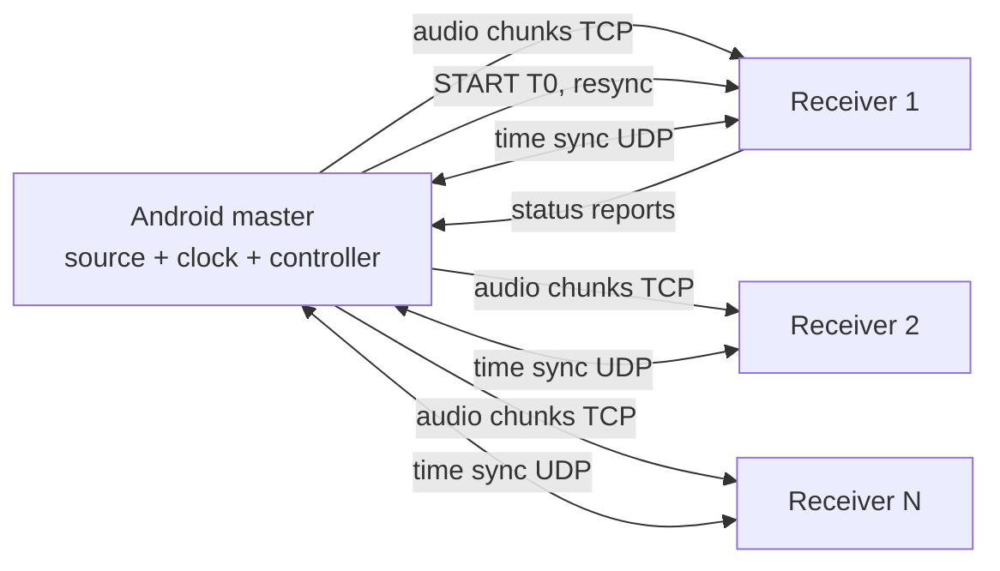

# Sync In It

<p align="center">
  
</p>

> Project goal: turn 6–10 phones into one synchronized speaker group over a private local network. The current engineering preview is Android-only.

**Project website:** [Sync In It](./frontend) — project overview and pre-release downloads page.

**Sync In It** is an offline, master-clock-based audio distribution system. One Android phone plays the role of audio source and master clock. Other Android or iOS phones play the same audio in sync over a private local Wi-Fi network. The current product target is 6–10 phones in total; exact receiver capacity remains an open design decision. It is designed for a single train coach (for example a Bandra-Delhi journey), with no internet, no cloud, and no dedicated speakers.

*Sync In It is a working name. Rename it freely.*

---

## Current implementation status

**The Android multi-Speaker implementation path is present; successful physical group playback is not yet demonstrated.**

The latest public pre-release is [`v0.5.7-preview.1`](https://github.com/Shreyas-patil07/Sync-in-it/releases/tag/v0.5.7-preview.1). It contains the multi-Speaker Host/Speaker networking path, generated PCM16 test-stream fan-out, bounded pre-ANCHOR buffering, a common future playback ANCHOR and M3a DAC timestamp diagnostics. The current product target remains 6–10 phones total; the Android Host implementation currently admits up to **8 Speakers**.

The latest supplied three-phone LAN run successfully discovered the Host, completed multiple control/audio TCP handshakes and exchanged UDP time-sync packets. **No Speaker reached READY before the 45-second readiness deadline**, so the Host removed the cohort and no group ANCHOR was scheduled. The pipeline is implemented, but physical multi-Speaker playback and acoustic synchronization are not verified. The immediate engineering focus is identifying whether the READY gate is blocked by clock acquisition, PCM delivery or both.

The Host opens a 15-second admission window after the first admitted Speaker. A Speaker needs a stable clock estimate and at least 3 seconds of contiguous PCM before READY. READY is retried every second until ANCHOR; repeated READY is idempotent. Each Speaker has a 20-second sample-indexed PCM ring buffer that rolls before ANCHOR and becomes strict after ANCHOR. The Host applies a 45-second readiness deadline and bounds each per-Speaker audio writer queue to approximately 500 ms. The source is a generated 1 kHz timing-click signal—not local music or system-audio capture.

M3a polls Android AudioTrack output timestamps and fits a rolling regression in the C++ core. It currently reports diagnostics only; it does not drive drift correction or output-latency compensation. DAC/acoustic alignment, microphone calibration, endurance measurements, robust reconnect and iOS support remain future work.

**Current-main build note:** PR #49 adds Speaker READY-gate and Host audio-delivery diagnostics. Its first Android/JNI CI run failed because `AtomicLong` was not imported in `MasterSessionHost.kt`. The current documentation branch includes that missing import; a fresh Android CI run is required before calling the diagnostic build green. The v0.5.7 release APK predates PR #49 and does not contain those newer diagnostic messages.

See [the canonical implementation status](docs/11_Current_Implementation_Status.md) for evidence, exact limits and the next test sequence.

| Milestone | Description | State |
|---|---|---|
| M0 | Python simulator, portable C++ timing core and shared vectors | Simulator/native CI passing; physical timing not implied |
| M1 | Android LAN discovery, TCP admission and UDP clock acquisition | Implemented; latest physical run did not reach READY |
| M2a | PCM16 codec and bounded sample-indexed jitter buffer | Implemented with native regression coverage |
| M2b | Android PCM16 TCP receive and AudioTrack test output | Implemented; physical playback still needs validation |
| M2c | Multi-Speaker admission and shared PCM fan-out (up to 8) | Implemented; latest physical READY gate failed |
| M2d | Shared future ANCHOR and sample-indexed group start | Implemented in code; no successful physical group start yet |
| M3a | AudioTrack timestamp polling and rolling output-clock regression | Implemented as diagnostics only |
| M3b/M4 | Callback-safe DAC mapping, drift correction and endurance | Not complete |
| M5 | Robust reconnect and 4+ Speaker resilience | Not validated / incomplete |
| M6 | User-selected/system audio source and Opus | Planned |
| M7 | iOS Speaker | Planned |
| M8 | Acoustic calibration | Planned |
| M9 | 6–10 phone scale and train trial | Planned |

### Run the M0 simulator

Requires Python 3.11 or newer. No runtime dependencies are required.

```bash
cd sim
python -m pip install -e .
python -m unittest discover -s tests -v
sync-in-it-sim --duration 60 --seed 7
sync-in-it-sim --lan --duration 60 --seed 7
```

The `--lan` mode compares fixed and adaptive clock probing while audio streams share one modeled Wi-Fi channel. It reports airtime utilization, audio p95 latency, group-delay misses, control RTT, queue waits, retries and drops. These outputs are synthetic, not router/device measurements.

M0 outputs are simulated, not measurements from Android devices. The default scenario run reports fixed-versus-adaptive acquisition comparisons for +30 ppm drift, high jitter and random packet loss. See [`sim/README.md`](sim/README.md) for gate definitions, probe overhead and limitations.

### Build and test the portable C++17 timing core

Requires CMake 3.20+, a C++17 compiler and Python 3.11+.

```bash
cmake -S core -B build/core -DCMAKE_BUILD_TYPE=Release
cmake --build build/core --config Release --parallel 2
ctest --test-dir build/core -C Release --output-on-failure
```

The build generates its C++ test data from [`protocol/vectors/m0_timing.json`](protocol/vectors/m0_timing.json). The Python test suite loads that same JSON directly. Passing parity tests proves algorithm agreement on the supplied vectors; it does not prove physical-device or acoustic synchronization.

### Build and test the Kotlin/JVM socket transport

Requires JDK 17 and Gradle 8.10.2 or newer.

```bash
gradle -p android/transport check
```

This compiles the JVM-compatible TCP/UDP adapter and runs loopback integration tests. It does not build an Android APK.


### Build the Android application shell

Requires JDK 17, Android SDK 36, NDK 30.0.16248370, CMake 3.22.1 and Gradle 8.13.

Run `gradle -p android :app:assembleDebug` to build the debug APK and `gradle -p android :transport:check` to run TCP/UDP transport checks.

The Android workspace and JNI boundary are documented in [android/README.md](android/README.md). The Android CI workflow publishes the debug APK as a short-lived artifact. Launching the debug app runs a small native session smoke test. It validates JNI/session wiring only; it does not connect phones or play audio.

For in-place APK updates, preview builds must be signed with the same persistent keystore and use a higher `versionCode`. Configure the two GitHub Actions secrets documented in [android/README.md](android/README.md) before downloading the updateable preview artifact or publishing a release. The package ID remains `com.syncinit.app.debug` for preview builds. Existing CI APKs signed with disposable runner keys may require one final uninstall/reinstall to migrate to the persistent signing key; future builds signed with that key install over the existing app.

---

## Why this is hard

Phones that receive identical audio still play it at different times. Each phone has its own audio clock, operating-system scheduling, output pipeline, and speaker. Starting playback when packets arrive produces echoes and drift.

Sync In It does not play audio on arrival. It gives every sample a target presentation time on a shared timeline and makes each phone hit that time. A deliberate group delay of 2-10 seconds provides the preparation time.

---

## How it works



Seven layers, each using the best-known technique:

| Layer | Job | Technique |
|---|---|---|
| L1 Transport | Deliver audio early | Timestamped chunks, deep buffer, TCP (Snapcast-style) |
| L2 Clock distribution | Shared notion of time | Lowest-RTT NTP-style exchange; optional RBS refinement |
| L3 Group playout control | One common deadline | IDMS-style reports and common target playout point (RFC 7272) |
| L4 DAC clock mapping | Master time to real output time | Platform output timestamps plus skew fit |
| L5 Drift correction | Hold alignment for hours | Sample drop/duplicate, gentle rate adjustment |
| L6 Acoustic alignment | Align sound in the air | Microphone chirp calibration; optional ultrasonic beacon |
| L7 Resilience | Survive a train | Quarantine, rejoin, adaptive delay |

### The core idea in four lines

```
M = local + theta                       # master time from local clock
T(n) = T0 + n / 48000                   # when stream sample n must be heard
n_expected(p) = ((M(p) + c_i) - T0) * 48000   # sample that frame p must carry
error e = n_expected - n_actual         # drift controller drives e to zero
```

`T0` is one start deadline for the whole group, set by the slowest receiver. `c_i` is a per-device compensation from calibration.

---

## Features (target)

- Fully offline operation over a local router
- Android master, Android and iOS receivers, one shared protocol
- Configurable group delay up to 10 seconds
- Continuous clock-offset and clock-skew estimation
- Automatic drift correction by sample drop/duplicate
- Receiver reconnect and resynchronization without disturbing others
- Manual per-device offset slider
- Microphone-based acoustic calibration at one listening position
- Per-device telemetry logs for debugging

---

## Synchronization targets

These are goals to be validated by measurement, not guarantees.

| Tier | Skew between phones | Meaning |
|---|---|---|
| T1 | 20 ms or less | Heard as a single sound source by most listeners |
| T2 | 10 ms or less | Solid result for mixed phones over Wi-Fi |
| T3 | 5 ms or less at the listening position | Stretch goal, needs calibration |

Results are reported as mean, maximum and 95th-percentile error. A literal zero-millisecond difference across different phones is not physically guaranteed.

---

## What you need

**Hardware**

- 1 Android phone for the master (Android 10+ for system audio capture)
- 2-10 receiver phones (Android and/or iOS)
- 1 portable dual-band Wi-Fi router (a phone hotspot works for early prototypes only)
- For iOS receivers: a Mac, Xcode, and physical iPhones
- For measurement: a laptop or third phone as a recorder

**Network**

- 5 GHz preferred, 2.4 GHz fallback
- Client isolation must be **off**
- No internet connection needed

---

## Android preview quickstart

The current Android preview implements one Host and admission for up to 8 Speakers. It sends a generated 1 kHz timing-click stream and contains a shared ANCHOR/AudioTrack path; physical group start is not currently verified because the latest run did not reach READY. Synchronized user-selected music is not implemented.

1. **Set up the local network.** Enable the Host phone's mobile hotspot, then connect the Speaker phones to it. No internet/mobile data is required for local traffic. A trusted Wi-Fi router also works when client-to-client traffic is allowed.
2. **Install the Android preview.** Use the latest signed pre-release from [GitHub Releases](https://github.com/Shreyas-patil07/Sync-in-it/releases). Install updates over the previous preview; do not uninstall it.
3. **Start the Host.** Open Sync In It on the Host phone and tap **Start hosting**.
4. **Join each Speaker.** Open Sync In It on each Speaker phone, tap **Refresh nearby sessions**, then select the Host.
5. **Check the Host count.** The Host should show the number of connected Speakers (for example, `2/8 connected`). Each Speaker independently acquires the Host clock and buffers PCM16.
6. **Capture diagnostics.** The Host's connected count confirms TCP admission, not readiness. Export logs from both Host and Speakers and look for `READY_GATE_BLOCKED`, `HOST_AUDIO_DELIVERY`, `Speaker READY` and `GROUP_START_SCHEDULED`.

**Important:** The latest supplied physical run discovered the Host and admitted multiple Speakers, but none reached READY before the startup deadline. Do not expect verified synchronized output from this preview yet. Hotspots can filter mDNS multicast or client-to-client traffic; confirm both are permitted. A QR/manual pairing fallback is not implemented. READY is a precondition for group start, not proof of acoustic synchronization.

---

## Intended architecture layout (not a literal current tree)

```
Sync In It/
  core/            # portable C++: time estimator, timeline, drift controller, group deadline
  android/
    master/        # Kotlin app: session, capture, controller
    receiver/      # Kotlin + Oboe receiver
    app/           # Android launcher shell and C++ JNI bridge
    transport/     # Pure Kotlin/JVM TCP and UDP socket adapters
  ios/
    receiver/      # Swift + AVAudioEngine receiver
  protocol/        # wire format spec and test vectors
  sim/             # Python simulator for clocks, jitter, loss
  tools/
    analyze/       # click-track recording analysis (cross-correlation)
    logs/          # telemetry plotting
  docs/            # primary product and engineering documentation
  docs_original/   # original source design documents
```

The portable `core/` library is designed to be shared by Android and iOS. Android currently integrates it through JNI; an iOS receiver and its bridge are not present in the current implementation.

---

## Protocol summary

| Channel | Transport | Content |
|---|---|---|
| Control | TCP (`TCP_NODELAY`) | HELLO, READY, START, PAUSE, STATS, RESYNC |
| Audio | TCP | Timestamped audio chunks |
| Time sync | UDP | Ping/pong with four timestamps |

Audio chunk header:

```
magic(2) version(1) type(1) session(4) seq(4)
sampleIndex(8) frames(2) codec(1) payloadLen(2) payload
```

Chunks are placed in the jitter buffer by `sampleIndex`, never by arrival order. All fields are little-endian. The protocol is platform-neutral so Android and iOS receivers behave identically on the wire. The normative protocol and data-schema draft is documented in [`docs/06_Protocol_and_Data_Schema.md`](docs/06_Protocol_and_Data_Schema.md); `protocol/` will hold implementation-ready definitions and golden test vectors.

---

## Clock synchronization in brief

```
RTT   = (t4 - t1) - (t3 - t2)
theta = ((t2 - t1) + (t3 - t4)) / 2        # master = local + theta
```

- Send bursts of about 20 requests at join, then periodic requests.
- Keep the lowest-RTT quarter of recent samples and take the median offset.
- Fit offset against local time to estimate skew in ppm.
- Optional experimental refinement: Reference Broadcast Synchronization, adopted only if measurements show it beats the baseline on phones.

---

## Drift correction in brief

| Error `e` | Action |
|---|---|
| Under about 0.1 ms | Do nothing (dead-band) |
| 0.1 ms to about 5 ms | Drop or duplicate single samples, at most about one per 10 ms |
| Over about 5 ms | Hard resync: jump the read pointer and log it |

Thresholds are starting values to be tuned by listening and measurement.

---

## Configuration *(planned)*

| Setting | Default | Notes |
|---|---|---|
| Group delay `D` | 3 s | Range 2-10 s, changed only at a coordinated boundary |
| Sample rate | 48 kHz | Fixed in v1 |
| Chunk size | 20 ms | |
| Jitter buffer | 3-5 s | |
| Time-sync interval | few seconds | Burst at join |
| Manual offset | 0 ms | Range about plus/minus 50 ms, 0.1 ms steps |
| Codec | PCM | Opus planned |

---

## Measuring sync

1. Generate a click-track with a click each second at known sample positions.
2. Put all phones about 10 cm from one recording microphone, at equal distance.
3. Play from all phones and record.
4. Cross-correlate or peak-detect per click, giving each phone a distinct click pitch if you use one mono recording.
5. Report mean, maximum and 95th-percentile arrival differences.

Per-device telemetry (CSV): offset, RTT, skew in ppm, buffer fill, error `e`, sample corrections, hard resyncs, underruns.

Test matrix: offset quality, acoustic skew, 60-minute endurance, scaling to 2/4/6/10 receivers, fault injection (disconnects, router reboot, congestion), and a real train trial.

---

## Resilience behavior

| Event | Behavior |
|---|---|
| Receiver disconnects | Others continue on the existing timeline |
| Receiver rejoins | Re-estimates offset, enters at a future coordinated boundary |
| Cannot catch up within `D` | Marked unavailable and kept silent |
| RTT or loss rises | Controller raises `D` at a coordinated boundary |
| Buffer underrun | Silence fill, counted, resync if repeated |
| Master loses router | Receivers play buffered audio, then stop cleanly |

On the master, use a foreground service, a partial wake lock, a high-performance Wi-Fi lock, and a battery-optimization exemption. On iOS, enable background audio and configure the audio session correctly. Validate all of this on the target phones.

---

## Known limitations

- Android can only capture audio from apps that allow it. Protected or restricted media may be unavailable. A local-file fallback is planned.
- Android and iOS use different native audio pipelines, so receivers are implemented separately on top of a shared core.
- Phone output latency and speaker hardware add device-specific delay that only calibration can reduce.
- A common digital deadline does not guarantee identical acoustic arrival. Calibration is valid only at one listening position and for the current phone placement. A train moves, so re-calibration will be needed.
- A long Wi-Fi outage can exceed the buffer and force a controlled resync.
- No published system I know of combines all these layers on mixed phones over Wi-Fi, so the integration is unproven. Microsecond-level numbers in the cited papers come from controlled hardware, not phone Wi-Fi stacks or phone speakers.

---

## Roadmap

1. Android-only demo: master plus 2-3 receivers with scheduled playback (M0-M5)
2. Opus and system audio capture (M6)
3. iOS receiver (M7)
4. Acoustic calibration (M8)
5. Scale to 6-10 receivers and train trial (M9)
6. Stretch: RBS refinement, mutual-microphone calibration, ultrasonic drift beacon

---

## Contributing

The project is in active engineering prototyping. Useful contributions include Android networking/audio review, clock-estimator analysis, reproducible multi-phone test logs, simulator scenarios and acoustic measurement methodology. Open an issue before large changes; for synchronization bugs include the build/version, phone models, network topology, Host and Speaker logs, and whether the failure occurred before READY or after ANCHOR.

---

## License

| Material | License |
|---|---|
| Source code (core, apps, simulator, tools, frontend) | [Apache License 2.0](LICENSE) |
| Documentation, specifications and reports | [Creative Commons Attribution 4.0](LICENSE-DOCS) |
| Project name, logo and brand images | All rights reserved |
| Third-party components | Their own licenses, listed in [THIRD_PARTY_NOTICES.md](THIRD_PARTY_NOTICES.md) |

See [LICENSING.md](LICENSING.md) for the full map, contribution terms and the rules for adding dependencies. Snapcast is an architectural reference only, and no Snapcast code is used in this repository.

---

## References

- Snapcast, synchronous multiroom audio: https://github.com/rusitschka/snapcast
- Elson, Girod, Estrin, *Fine-Grained Network Time Synchronization Using Reference Broadcasts* (OSDI 2002): https://usenix.org/conference/osdi-02/fine-grained-network-time-synchronization-using-reference-broadcasts
- RFC 7272, Inter-Destination Media Synchronization (IDMS) Using RTCP: https://www.rfc-editor.org/info/rfc7272
- Adaptive and standardized RTCP-based IDMS (thesis): https://ir.cwi.nl/pub/23633
- Lazik et al., *Ultrasonic Time Synchronization and Ranging on Smartphones*: https://ptolemy.berkeley.edu/projects/terraswarm/pubs/492.html
- Android CDD change on output timestamp accuracy: https://android.googlesource.com/platform/compatibility/cdd/+/f845c6c%5E%21/
- Oboe `AudioStream` (getTimestamp, latency): https://android.googlesource.com/platform/external/oboe/+/10cd299e/include/oboe/AudioStream.h
- Patent, multi-device audio playback correction: https://patents.google.com/patent/US12401947
- Patent application, microphone-based playback delay: https://www.goveda.com/patent/CN-122002178-A