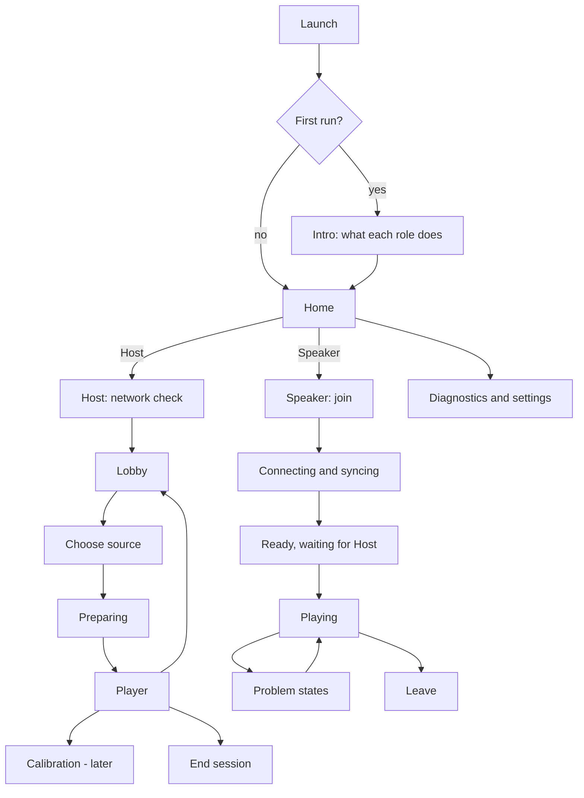
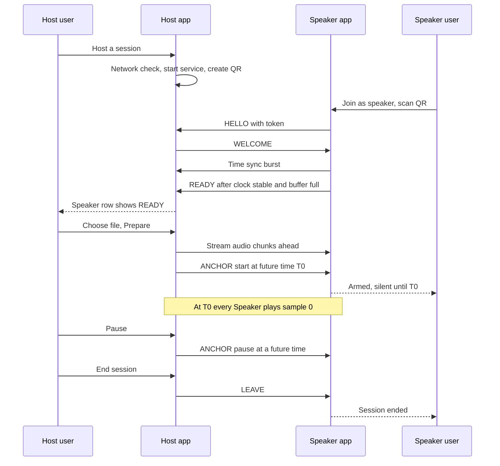

# App Workflow: Host and Speaker — Sync In It

**Document status:** Draft v2.0 (replaces `04_App_Flow.md` v1.0)  
**Last updated:** 2 November 2026  
**Scope:** Step-by-step user workflow for the Host and Speaker roles, screen by screen, with permissions, interruptions, errors, and what each milestone builds.

---

## 0. Terminology and scope

### 0.1 User-facing names

The apps use **Host** and **Speaker**. The protocol, core code and the other design documents keep the internal names **master** and **receiver**.

| User-facing | Internal | Meaning |
|---|---|---|
| **Host** | master | The phone that holds the audio, runs the clock and controls the group |
| **Speaker** | receiver | A phone that plays the audio in sync |
| **Session** | session | One hosted group, from "Start session" to "End session" |
| **Speaker list / group** | receiver set | The phones currently in the session |

### 0.2 Platform scope

- One Android app with both roles (ADR-002).
- iOS is Speaker-only and is **blocked for now** because there is no Mac available. The flows below apply unchanged when it arrives.
- Test hardware today: 3 Android phones, so one Host and two Speakers.

### 0.3 First release scope (Demo v0.1)

| Included | Deferred |
|---|---|
| Host with local audio file | Live capture from other apps (M6) |
| 2-3 Android Speakers | iOS Speaker (M7) |
| Manual timing offset per Speaker | Automatic calibration (M8) |
| Diagnostics export | Opus codec (M6) |
| Identify, mute and remove a Speaker | 6-10 phone scale (M9) |

Screens marked *(later)* below are designed now so the structure holds, but are built at the milestone listed in section 11.

---

## 1. App map

Rules for the whole app:

1. The app never starts hosting or joins a session on its own. Home always asks (remembering the last role only as a highlighted suggestion).
2. Only one role is active at a time. Switching roles requires ending or leaving the current session.
3. Portrait only in v0.1.
4. Every state shown to the user comes from the core state machine. The UI never invents a "ready" state.

---

## 2. First launch and permissions

### 2.1 Intro (first run only, 3 cards)

1. **One phone hosts the audio.**
2. **Other phones become speakers.** All phones join the same Wi-Fi router. No internet is needed.
3. **Keep phones in the same spot.** Sync is tuned for where the phones sit.

Buttons: *Get started*. No sign-in, no account.

### 2.2 Permissions are requested in context, never up front

| Permission | When asked | What the user sees first | If denied |
|---|---|---|---|
| Camera | Speaker taps *Scan QR* | "To scan the Host's QR code" | Manual code entry is offered |
| Notifications (Android 13+) | First Host session start, or first Speaker join | "A notification keeps playback running while the screen is off" | Continue, with a warning that Android may stop playback in the background *(verify behavior)* |
| Battery optimization exemption | After the first successful join or session start | "Prevents Android from pausing sync in the background" | Continue with a reminder in Diagnostics |
| Microphone | Host opens Calibration, or starts live capture *(later)* | "Used only to measure speaker timing" | Calibration unavailable; manual offset offered |
| Screen capture consent | Host starts live capture *(later)* | System prompt, preceded by an explanation | File mode offered |
| Files | Host taps *Choose file* | System file picker (no storage permission needed) | n/a |
| Local Wi-Fi / hotspot permissions | Only if hotspot mode is added | Explained when needed | Router mode only |

*(Android permission names and behavior change between versions. Verify on your test devices.)*

---

## 3. Host workflow

### H0. Home

- Two large buttons: **Host a session** and **Join as speaker**.
- Footer: *Diagnostics*, *About and licenses*.
- If an earlier session was interrupted, show a note ("Your last session ended unexpectedly") and offer *Export diagnostics*. Never resume it automatically.

### H1. Network check

Purpose: catch the most common failure (wrong network) before anyone scans anything.

Checks shown as a short list with ticks:

| Check | Pass | Fail message |
|---|---|---|
| Connected to Wi-Fi | Network name shown | "Connect to the router's Wi-Fi first" with a *Wi-Fi settings* button |
| Has a local address | Address shown (for example 192.168.x.x) | "No local address. Reconnect to Wi-Fi" |
| Band | "5 GHz" or "2.4 GHz" | 2.4 GHz is allowed with a hint: "5 GHz is more stable with many speakers" |
| App can use this Wi-Fi | App binds to the Wi-Fi network | "Android is routing traffic over mobile data. Turn off automatic switching to mobile data" *(verify)* |

Primary button: **Start session**. It stays disabled until the first two checks pass. The third and fourth produce warnings but do not block.

The Host cannot detect Wi-Fi client isolation by itself. That is diagnosed when a Speaker fails to reach it (see S1 and section 7).

Starting the session (internal): start the foreground service, bind the control, audio and time-sync ports, create the session ID and token. If a port cannot be bound, show "Could not start the session" with the reason and do **not** show a QR code.

### H2. Lobby

Purpose: gather Speakers and confirm each one is healthy.

**Layout, top to bottom**

1. Large QR code with the text "Scan with Sync In It on the other phones".
2. Network line: network name, band, Host address.
3. Short manual code (for example `482 913`) and address, for phones that cannot scan *(later: see 10.2)*.
4. Speaker list, "2 of 10 speakers".
5. Primary button **Choose audio**. Secondary: *End session*.

**Speaker row**

| Item | Content |
|---|---|
| Name | Editable label, default is the phone model; optional seat label such as "Seat 2" |
| State chip | CONNECTING, SYNCING, BUFFERING, READY, PLAYING, DEGRADED, MUTED (text plus color) |
| Buffer bar | Seconds buffered versus the required amount |
| Sync badge | Good, Fair, Poor, Unavailable (an estimate, not a guarantee) |
| Actions | **Identify**, **Rename**, **Mute**, **Remove** |

**Identify.** The Host taps it and that Speaker flashes its screen and plays a short beep. This is essential once several identical phones are on a seat table. It is only allowed in LOBBY or PAUSED.

**Toggles**

- *Allow late joins* (default on).
- *Keep screen awake* (default off).

**Admission rules**

1. A Speaker appears the moment its HELLO is accepted, in state CONNECTING.
2. Rows update from each Speaker's reports. A connected socket is never shown as READY.
3. Wrong token, version mismatch and a full session are refused by the protocol and appear as a short notice on the Host ("A phone tried to join with the wrong code").

### H3. Choose audio

*v0.1: file only.*

- Button **Choose audio file** opens the system file picker. Supported types are whatever the Android decoder handles (MP3, AAC, WAV, FLAC, OGG are expected *(verify)*).
- After picking: show title, duration, and a note "This file will be converted to 48 kHz for sync".
- Decode errors show "This file can't be played. Try another file".
- *(later, M6)* **Capture another app**: explains the limits first ("Some apps do not allow capture") and then shows the system consent prompt. If denied or blocked, offer file mode.

Primary button: **Prepare**.

### H4. Preparing

Purpose: stream ahead and wait until every Speaker is genuinely ready.

Per Speaker: clock sync status, buffer filled versus required, and READY or a blocking reason (for example "Clock unstable", "Waiting for audio", "Slow connection").

**Start policy**

1. Default: start only when **all** admitted Speakers are READY.
2. After 30 seconds with some Speakers not ready, offer **Start with N ready speakers**. The unready ones are shown as "Waiting" and join later at a future boundary; they never play from arrival.
3. The Host can **Remove** any Speaker at any time.

When the policy is met the Host computes one future start time and sends the start anchor to everyone. The screen shows "Starting in 3, 2, 1" based on the real deadline, not a fixed delay.

### H5. Player

**Layout**

- Title and source type ("File").
- Large **Play / Pause** control. Seek bar for files.
- Status line: "Playing in sync · 3 speakers", or "1 speaker needs attention".
- Speaker chips (compact), tapping opens the row actions.
- Group volume slider.
- Buttons: *Add speaker* (shows the QR sheet), *Mute all*, *End session*.

**Behavior**

| Action | What happens | What the user sees |
|---|---|---|
| Play (from prepared) | Start anchor with a future deadline | Short countdown, then Playing |
| Pause | Pause anchor a short moment ahead | All Speakers stop together, state "Paused" |
| Resume | Resume anchor a short moment ahead | Short countdown, all resume together |
| Seek | Stream from the new position, wait until buffered, then a future seek anchor with a short crossfade | "Buffering…" briefly, then Playing |
| Group volume | Volume command applied at a shared time | Slider updates |
| Mute all | Mute command to all | "Muted" label |
| Add speaker | Lobby QR sheet while playing | New Speaker joins at a future boundary |

Pause, resume and seek exist only for files. Live capture *(later)* will not show them.

When playback reaches the end of the file: the timeline stops, the screen shows "Finished" with *Play again*, *Choose another file* and *End session*.

### H6. Calibration *(later, M8)*

Steps shown one per screen:

1. **Place the microphone.** "Put this phone where you will sit. Keep it still."
2. **Place the speakers.** "Put the speaker phones where they will play."
3. **Quiet please.** "The speakers will each play a short sound, three times."
4. **Measuring.** Progress per Speaker.
5. **Results.** Per Speaker: measured delay, confidence, compensation. Buttons: *Apply*, *Repeat*, *Reset*, *Fine-tune*.

Low-confidence results are never applied automatically; they show "Result unreliable. Repeat in a quieter moment". After any Speaker is moved, the results are marked "Needs recheck".

Until M8, Speakers use the manual offset (S6) as the calibration tool.

### H7. End session

1. **End session** asks "End the session for all speakers?".
2. The Host sends a stop and LEAVE to every Speaker, then stops capture, sockets, locks and the foreground service.
3. Summary screen: duration, number of speakers, count of resyncs and underruns, **Export diagnostics**.
4. Return to Home.

If the app is swiped away or killed, Speakers see "Host lost" (S5).

---

## 4. Speaker workflow

### S1. Join

**Layout:** camera view for the QR code, with a link **Enter code instead**.

1. The Speaker taps **Join as speaker** on Home.
2. Camera permission is requested (section 2.2). If denied, go to manual entry.
3. After a valid scan the app connects. The user does nothing else.
4. Manual entry *(later: see 10.2)*: Host address and code.

Failure messages:

| Cause | Message |
|---|---|
| QR is not a Sync In It code | "That is not a Sync In It code" |
| Cannot reach the Host within 8 seconds | "Can't reach the Host. Check that both phones are on the same Wi-Fi and that the router's client isolation is off" |
| Wrong or expired code | "This session code is not valid. Ask the Host to show the code again" |
| Different app versions | "The Host runs a different version of the app. Update both phones" |
| Session full | "This session is full" |

### S2. Connecting and syncing

One screen with four steps that tick off in order:

1. **Connected** to the Host.
2. **Clock aligned** (SYNCING to stable).
3. **Audio buffered** (BUFFERING to full).
4. **Ready**.

Shows the Host name and the Speaker's own name, with a **Cancel** button. Each step has a timeout (30 seconds for clock alignment, 30 seconds for buffering). On timeout: "Still trying… Move closer to the router" and a *Retry* button. The Speaker never plays during this stage.

### S3. Ready, waiting for the Host

- Big text: **Ready. Waiting for the Host to start.**
- Compact status: Host name, sync badge, buffer level.
- Controls: local volume, *Settings*, *Leave*.
- When the Host sends the start anchor: show "Starting…" and move to S4. The Speaker outputs silence until the exact start time.

### S4. Playing

A deliberately quiet screen so the phone can sit on a table or in a pocket:

- Large state word: **Playing**.
- Sync badge (Good, Fair, Poor) with the label "estimate".
- Local volume slider and the Host's group volume indicator.
- Output route label ("Phone speaker", "Headphones").
- *Leave* button, behind a confirm.

The screen may turn off; playback continues through the foreground service. An optional *Keep screen on* switch exists in Settings.

### S5. Problem states

| State | Trigger | Speaker screen | Host sees | Recovery |
|---|---|---|---|---|
| **Degraded** | Timing error above the preferred band for a while | "Timing is drifting. Still playing" | Chip DEGRADED | Automatic; escalates to Muted if it worsens |
| **Resyncing** | Hard resync or catching up | "Re-aligning…" (brief) | Chip RESYNCING | Automatic |
| **Muted** | Cannot meet the timeline safely | "Paused to stay in sync" and a *Rejoin* button | Chip MUTED, then "Unavailable" after 30 s | Automatic rejoin, or the user taps *Rejoin* |
| **Reconnecting** | Connection lost | "Reconnecting to Host…" | Speaker dropped from the active list | Retries; re-enters at a future boundary |
| **Host lost** | No keepalive for 5 s and buffer exhausted | "The Host stopped. Ask them to start again" | n/a | *Scan again* or *Leave* |
| **Output changed** | Headphones or Bluetooth connected or removed | Banner with the route name | Warning on the row | Rebuild output mapping and resync |

A Speaker in a problem state never plays out-of-sync sound on purpose. It keeps playing only while timing is still inside the safe band.

### S6. Settings

| Setting | Behavior |
|---|---|
| Speaker name | Editable; shown to the Host |
| Channel | Mono (default), Left, Right |
| Local volume | Multiplies with the Host's group volume |
| Timing offset | Slider, about ±50 ms in 0.1 ms steps, with *Reset*. Moves this phone's sound earlier or later relative to the group. It does not change the shared timeline |
| Keep screen on | Off by default |
| Diagnostics | Summary and advanced values, *Export* |

There is **no** control for "playback delay" on a Speaker, because that would break the shared timeline (design decision D12).

### S7. Leave

*Leave* asks for confirmation, sends LEAVE, closes sockets, releases locks and returns to Home. The Host list updates immediately.

---

## 5. Session lifecycle (Host and Speaker together)

Ordering rules (carried over from v1):

- A network connection is not a ready Speaker, and READY is not PLAYING.
- The Host's anchor is the only authority for start, pause, resume and seek.
- Audio packet arrival never starts playback.
- A late joiner never changes the timeline for healthy Speakers.
- Calibration results are applied only after confidence checks pass.
- Every transition has a timeout, a failure state and a diagnostic event.

---

## 6. Interruptions and device conditions

| Condition | Host behavior | Speaker behavior |
|---|---|---|
| Screen off or phone locked | Keeps running through the foreground service and wake lock | Same |
| App sent to background | Same | Same |
| App swiped away or killed | Session ends; Speakers see "Host lost" | Leaves; the Host list updates |
| Incoming call | Streaming continues; the Host's own sound is already muted | Call takes audio focus, so the Speaker goes MUTED ("Phone call"), then rejoins automatically afterwards |
| Another app takes audio focus | No effect (file mode) | Speaker goes MUTED, requests focus back, rejoins |
| Wi-Fi drops briefly | Reconnect handling per Speaker | Plays from buffer, then reconnects |
| Android routes traffic to mobile data because Wi-Fi has no internet | Bind the app to the Wi-Fi network; warn if not possible *(verify)* | Same |
| Battery saver or low battery | Warn once; prompt for the battery exemption | Same; also show the warning on the Host row when the Speaker reports low battery *(optional report field)* |
| Phone gets hot | Warn when a thermal status is reported *(verify)* | Same |
| Bluetooth speaker or headphones connected | n/a | **Warn: "Bluetooth output adds delay that sync cannot measure reliably. Use the phone speaker."** Mark the row Poor |
| Wired headphones | n/a | Allowed; route label shows "Headphones" |
| Volume at zero | n/a | Badge "Silent" so users do not think it is broken |
| Device rotation | Locked to portrait in v0.1 | Same |
| Do Not Disturb | Media still plays; no change | Same |

---

## 7. Errors and messages

User-facing text is short and says what to do. The same text is used in the app resources so it can be translated.

| Situation | Where | Message | Action offered |
|---|---|---|---|
| No Wi-Fi | Host H1 | "Connect to the router's Wi-Fi first." | Wi-Fi settings |
| Port in use | Host H1 | "Could not start the session. Close other copies of the app and try again." | Retry |
| Speaker cannot reach Host | Speaker S1 | "Can't reach the Host. Same Wi-Fi? Client isolation off?" | Retry, show checklist |
| Wrong code | Speaker S1 | "This session code is not valid." | Scan again |
| Version mismatch | Both | "Update the app on both phones." | none |
| Session full | Speaker S1 | "This session is full." | none |
| Clock cannot stabilize | Speaker S2 | "Can't align clocks. Move closer to the router." | Retry |
| Buffer too slow | Host H4 | "Speaker X is receiving audio slowly." | Wait, Remove |
| File cannot be decoded | Host H3 | "This file can't be played. Try another file." | Choose file |
| Capture blocked *(later)* | Host H3 | "This app does not allow audio capture." | Use a file |
| Microphone denied | Host H6 | "Calibration needs the microphone. You can adjust timing manually instead." | Manual offset |
| Calibration unreliable | Host H6 | "Result unreliable. Repeat in a quieter moment." | Repeat |
| Host lost | Speaker | "The Host stopped. Ask them to start again." | Scan again |
| Audio device lost | Speaker | "Audio output changed. Re-aligning…" | automatic |

Not-a-promise rule: the app never says "perfectly synced". It says "Good", "Fair" or "Poor", with the word "estimate" where a number is shown.

---

## 8. Screen-to-state mapping

| Screen | Core state (internal) | Events that update it |
|---|---|---|
| H1 Network check | none (pre-session) | Network callbacks |
| H2 Lobby | Master LOBBY | HELLO accepted, REPORT, LEAVE, keepalive loss |
| H3 Choose audio | LOBBY | File decoded |
| H4 Preparing | PREPARING | READY, REPORT, 30 s timeout |
| H5 Player | PLAYING or PAUSED | Anchors reaching their time, REPORT, end of file |
| H6 Calibration | CALIBRATING | CALIB_ACK, calibration result |
| H7 End | ENDED | LEAVE sent |
| S1 Join | DISCONNECTED, CONNECTING | WELCOME or ERROR |
| S2 Connecting and syncing | CONNECTING, SYNCING, BUFFERING | Estimator stable, buffer full |
| S3 Ready | READY | ANCHOR start |
| S4 Playing | ARMED, PLAYING | Start time reached |
| S5 Problem states | DEGRADED, RESYNCING, MUTED, DISCONNECTED | Drift controller, keepalive, route change |

The UI only renders these states. It never decides on its own that a Speaker is ready or in sync.

---

## 9. Protocol additions this workflow needs

These are not in the current protocol draft. Each needs an ADR entry and test vectors before implementation.

| New item | Direction | Used by | Notes |
|---|---|---|---|
| `IDENTIFY` | Host to Speaker | Lobby *Identify* button | Short beep and screen flash; refused while PLAYING |
| `SET_LABEL` | Host to Speaker | *Rename* | Or a label field in HELLO plus a rename message |
| Speaker `label` in HELLO | Speaker to Host | Lobby row names | Defaults to the phone model |
| `batteryPct` and `lowBattery` flag in REPORT | Speaker to Host | Warnings | Optional |
| `outputRoute` in REPORT (speaker, wired, bluetooth, other) | Speaker to Host | Bluetooth warning | Needed for the Bluetooth rule |
| Removal reason in LEAVE | Host to Speaker | *Remove* | Uses the existing LEAVE with a reason code |
| Short pairing code | Host to Speaker | Manual join | See 10.2 |

---

## 10. Options and open questions

### 10.1 "Host also plays" (strong option for 3-phone testing)

The design mutes the Host so it does not add an unsynchronized sound source. But the Host can run a local Speaker engine of its own. For the Host the clock offset is zero, and it has its own output timestamps, so it can follow the same timeline as the others. With three phones that gives **three synchronized speakers** instead of two. Proposed as a Host toggle after M5, off by default. It needs an ADR because it changes the "Host is muted" rule in the system design.

### 10.2 Manual join without a camera

The QR token is 128 bits, which is too long to type. Proposed fallback: the Host shows its address and a 6-digit pairing code, the Speaker types both. A short code is weak on its own, so limit attempts (for example 3 tries, then a 30 second lock) and keep the code valid only while the lobby is open. This is a convenience for a private router, not strong authentication (see ADR-011 and ADR-015).

### 10.3 Other open points

| # | Question | Suggested default |
|---|---|---|
| Q1 | Start policy: wait for all, or allow start with the ready ones after a timeout? | Wait for all; offer "start with ready speakers" after 30 s |
| Q2 | Should the Host allow late joins by default? | Yes, with a toggle |
| Q3 | Must Speaker names be unique? | No; show model plus a short suffix if duplicated |
| Q4 | Languages | English first; keep all strings in resources so Hindi and Marathi can be added |
| Q5 | Show a "test sound" button that plays a synchronized click on all Speakers? | Yes, after M3, because it lets users hear whether sync is good |
| Q6 | Should the Speaker screen go dark to save battery? | Yes after 30 s, with a tap to wake |

---

## 11. What gets built at each milestone

| Milestone | Host screens | Speaker screens |
|---|---|---|
| M1 Time sync on two phones | Home, minimal lobby, diagnostics (raw offset and RTT) | Join by typing the Host address, diagnostics |
| M2 Scheduled start | H1 network check, H3 file picker, H4 preparing, H5 player (play only) | S2, S3, S4 |
| M3 Manual offset | Player shows per-Speaker offset values | S6 timing offset slider |
| M4 Drift control | Sync badges, DEGRADED and MUTED chips, export | S5 problem states |
| M5 Group and reconnect | Identify, rename, remove, mute, late join, Add speaker sheet | Reconnecting, Host lost, auto-rejoin |
| M6 Source expansion | Capture another app, codec options | no change |
| M7 iOS | none | S1 to S7 on iOS |
| M8 Calibration | H6 calibration flow | Chirp handling (no new screens) |
| M9 Scale and train | Capacity handling, 6-10 speaker list scrolling | none |

---

## 12. Acceptance checks for the workflow

1. A first-time user can host and have one Speaker playing in under two minutes without reading documentation.
2. A Speaker never makes sound before the Host's start time.
3. A Speaker that loses sync is shown as degraded or muted on both phones within a few seconds.
4. Every error in section 7 can be triggered in a test and shows the expected message and action.
5. Killing the Host app shows "Host lost" on every Speaker.
6. Connecting a Bluetooth output shows the Bluetooth warning.
7. All status is readable without color alone and with large system fonts.
8. No timing value is shown without units, and nothing claims perfect sync.