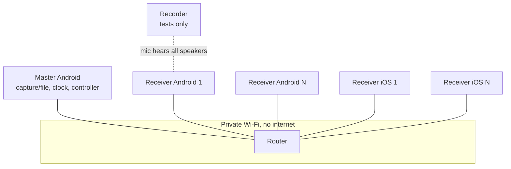

# Sync In It: Complete System Structure and Detailed Design

> **Current-state warning (6 November 2026):** This is a detailed target architecture/specification, not a description of all shipped functionality. The repository currently has an Android-only engineering preview with multi-Speaker networking/PCM start code; the latest physical run completed TCP admission and UDP responses but no Speaker reached READY. DAC regression is diagnostic only; drift integration, acoustic calibration, user-media sources, robust reconnect and iOS remain incomplete. Refer to [docs/11_Current_Implementation_Status.md](../docs/11_Current_Implementation_Status.md) for current implementation, CI and physical-test evidence.


*Version 0.2, November 2026. Refines `Sync-Engine.md` (v1) into an implementable structure: modules, interfaces, state machines, protocol, algorithms, procedures, testing, and open decisions.*

---

## 0. How to read this document

- `Sync-Engine.md` says **what** the system is and **why**. This document says **how it is built**.
- Everything marked **[D#]** is a design decision. They are collected in section 2 and again, with the ones still open, in section 19.
- Values marked *(tunable)* are starting points to be changed after measurement.
- Platform API behavior I could not verify here is marked *(verify)*. Check it on real devices before relying on it.

### Conventions

| Item | Convention |
|---|---|
| Time | `int64` nanoseconds, always. No floating-point time except inside regression fits |
| Clocks | `LocalTime` (this phone's monotonic clock) and `MasterTime` (master's monotonic clock) are **different types** so they cannot be mixed by accident |
| Samples | `SampleIdx` is `int64`, the position in the stream, starting at 0 |
| Sample rate | `Fs = 48000` Hz fixed in v1 |
| Byte order | Little-endian on the wire |
| Naming | `M` master time, `theta` offset, `T0` start deadline, `c_i` per-device compensation, `D` group delay |

---

## 1. System context

### 1.1 Actors and components

| Component | Role |
|---|---|
| **Master phone** (Android) | Audio source, authoritative clock, session manager, group controller. Its own speaker is muted |
| **Receiver phones** (Android or iOS) | Play the stream on the shared timeline |
| **Router** | Dedicated portable Wi-Fi router, client isolation off |
| **Recorder** (tests only) | Laptop or third phone recording all speakers for skew measurement |
| **Listener** | Sits at the calibration position |

### 1.2 Deployment view



### 1.3 Three flows

| Flow | Direction | Transport | Rate |
|---|---|---|---|
| Audio | Master to each receiver | TCP | about 1.5 Mbps per receiver (PCM stereo) |
| Control | Both ways | TCP | a few messages per second |
| Time sync | Receiver to master and back | UDP | burst at join, then every 2 s |

---

## 2. Design decisions

| ID | Decision | Rationale |
|---|---|---|
| D1 | **One Android app with two modes** (Master / Receiver) | Any Android phone can be master or receiver. One APK to install and test |
| D2 | **Two TCP connections per receiver (control, audio) plus one UDP socket for time sync** | A single TCP connection would let large audio chunks delay control messages (head-of-line blocking) |
| D3 | **Networking written once in C++ (`core/net`, POSIX sockets)** | Timestamps are taken in the same place on Android and iOS, and the code is shared |
| D4 | **Python reference model first, then C++ core, linked by shared golden test vectors** | Fast tuning in Python, then proof that C++ behaves identically |
| D5 | **Stream stereo PCM16; receivers downmix to mono by default** | Phone speakers are small. Optional L/R channel pick lets two phones act as a stereo pair later |
| D6 | **PCM first, Opus later (M6)** | Validate timing before adding codec latency and complexity |
| D7 | **Chunk = 20 ms (960 frames)** | Matches Opus frame size and is a reasonable granularity for buffering |
| D8 | **Timeline is a list of anchors** `{masterTime, sampleIdx, playing}` | Start, pause, resume, seek and group-delay changes are all "add an anchor", not special cases |
| D9 | **Session token in the QR, sent in HELLO** | Keeps strangers off the session. Adequate on a WPA2 private router. Stronger auth is a later option |
| D10 | **Targets: Android minSdk 26 (master features need API 29), iOS 15+** *(verify)* | AAudio exists from API 26. Playback capture needs API 29 |
| D11 | **Live-capture mode and file mode share one engine** | File mode is the same pipeline with the file decoder as the source. It is the guaranteed fallback when capture is blocked |
| D12 | **Receivers never choose their own delay** | All timing comes from the timeline plus the device compensation `c_i` |

---

## 3. Repository structure

```
sync-in-it/
  README.md
  LICENSE
  docs/                         # (rename of "Design Documents/")
    Sync-Engine.md              # system design v1
    System-Structure.md         # this document
    test-reports/               # measurement results, graphs, run logs
  protocol/
    PROTOCOL.md                 # normative wire spec (section 8 grows into this)
    vectors/                    # golden test vectors (JSON): packets, estimator, drift
  core/                         # portable C++17, no OS-specific code outside net/
    CMakeLists.txt
    include/syit/
      types.h                   # Ns, LocalTime, MasterTime, SampleIdx, Result
      clock.h                   # IClock interface
      protocol.h                # message structs, encode/decode
      offset_estimator.h
      timeline.h
      dac_clock_map.h
      jitter_buffer.h
      drift_controller.h
      group_controller.h
      session_master.h
      session_receiver.h
      calibration.h
      codec.h                   # PCM now, Opus later
      telemetry.h
      seqlock.h  spsc_ring.h    # lock-free helpers
      net.h                     # sockets abstraction
    src/                        # implementations
    tests/                      # unit tests (Catch2 or GoogleTest)
  sim/                          # Python reference model + simulator
    syit_sim/
      clocks.py                 # skewed clocks, DAC clock
      network.py                # delay, jitter, asymmetry, loss, spikes
      estimator.py              # reference OffsetEstimator
      drift.py                  # reference DriftController
      scenarios.py              # scenario catalogue (section 14)
      metrics.py
    tests/
    run_scenarios.py
  android/                      # single app, two modes
    app/                        # Kotlin UI, services, permissions
    native/                     # JNI bridge, Oboe output/input, links core
  ios/
    SyncInIt/                   # SwiftUI receiver app
    Bridge/                     # Obj-C++ bridge to core
  tools/
    clicktrack/                 # generates click-track WAV with known sample positions
    analyze/                    # recording analysis (cross-correlation, p95 report)
    logs/                       # telemetry CSV plotting
  .github/workflows/            # CI: build core, run unit tests and simulator
```

### 3.1 Dependency rules

1. `core/` depends only on the C++ standard library, plus `net/` for POSIX sockets. It must build on a laptop with no phone SDK.
2. `core/` never calls platform audio APIs. It receives and returns plain buffers and timestamps through small interfaces.
3. Platform code (`android/`, `ios/`) depends on `core/`, never the reverse.
4. `sim/` depends on nothing in `core/`. Parity is proven only by the shared vectors in `protocol/vectors/`.
5. Time always comes from an injected `IClock`, so the same code runs on a phone, in unit tests, and in the simulator.

---

## 4. Core library modules

Each module lists purpose, main interface, and invariants. Signatures are sketches to be refined at implementation time.

### 4.1 `types` and `clock`

```cpp
using Ns = int64_t;
struct LocalTime  { Ns v; };   // this device's monotonic clock
struct MasterTime { Ns v; };   // master's monotonic clock
using SampleIdx = int64_t;

class IClock {
 public:
  virtual LocalTime now() const = 0;   // monotonic, ns
  virtual ~IClock() = default;
};
```

Invariant: `LocalTime` and `MasterTime` never convert except through `OffsetEstimator`.

### 4.2 `protocol`

Encodes and decodes every message in section 8. Pure functions with no I/O.

```cpp
struct Header { uint8_t type; uint8_t flags; uint32_t length; };
Result<Message> decodeControl(std::span<const uint8_t> frame);
size_t          encode(const Message&, std::span<uint8_t> out);
Result<AudioChunk> decodeAudioChunk(std::span<const uint8_t> frame);
size_t          encodeTimeReq (const TimeReq&,  std::span<uint8_t> out);
Result<TimeResp> decodeTimeResp(std::span<const uint8_t> frame);
```

Invariants: decoding never reads past the buffer; unknown message types are skipped using the length field; the version is checked in HELLO.

### 4.3 `offset_estimator` (L2)

Turns four-timestamp exchanges into a mapping between local and master time.

```cpp
struct TimeSample { LocalTime t1; MasterTime t2, t3; LocalTime t4; };

class OffsetEstimator {
 public:
  explicit OffsetEstimator(const EstimatorConfig&);
  void addSample(const TimeSample&);
  bool stable() const;
  MasterTime toMaster(LocalTime) const;   // M = t + theta0 + skew*(t - t0)
  LocalTime  toLocal(MasterTime) const;
  EstimatorStats stats() const;           // thetaNs, skewPpm, rttMin, rttMedian,
                                          // residualStdNs, samplesUsed, spanSeconds
};
```

Algorithm in section 9.1. Invariants: skew is clamped to +/-200 ppm *(tunable)*; `stable()` is false until the window is long enough and residuals are small.

### 4.4 `timeline`

The shared playback schedule. Defined by anchors (D8).

```cpp
struct Anchor { MasterTime t; SampleIdx n; bool playing; };   // from time t, sample n is due

class StreamTimeline {
 public:
  void setSampleRate(uint32_t fs);
  void appendAnchor(const Anchor&);         // anchors are time-ordered
  SampleIdx expectedSample(MasterTime) const;   // n_anchor + (m - t_anchor)*Fs while playing
  bool      isPlaying(MasterTime) const;
  MasterTime dueTime(SampleIdx) const;
  Anchor     anchorAt(MasterTime) const;
};
```

Anchor effects: **start** adds `{T0, 0, playing}`. **Pause** adds `{Tp, n_at_Tp, not playing}`. **Resume** adds `{Tr, n_at_Tp, playing}`. **Seek** adds `{Ts, n_new, playing}`. **Group-delay change** adds `{Td, n_shifted, playing}`.

### 4.5 `dac_clock_map` (L4)

Maps output frame positions to local time using timestamps the audio API reports.

```cpp
class DacClockMap {
 public:
  void addTimestamp(int64_t framePos, LocalTime presentedAt);
  LocalTime presentTime(int64_t framePos) const;   // when frame leaves the pipeline
  double    effectiveRateHz() const;               // real DAC rate, about Fs +/- tens of ppm
  bool      valid() const;
};
```

Fits `t = a + b*frame` by regression over a sliding window (section 9.2). The audio callback never fits; it only reads a published snapshot.

### 4.6 `jitter_buffer`

Random-access ring of decoded PCM keyed by `SampleIdx` (not arrival order).

```cpp
class JitterBuffer {
 public:
  JitterBuffer(size_t capacityFrames, uint8_t channels);
  bool     put(SampleIdx first, const int16_t* pcm, uint32_t frames);  // idempotent
  uint32_t read(SampleIdx at, int16_t* out, uint32_t frames);          // missing frames zero-filled
  SampleIdx oldest() const;  SampleIdx newest() const;
  uint32_t  bufferedMs(SampleIdx playPos) const;
  GapStats  gaps() const;
};
```

Invariants: single producer (network thread), single consumer (audio thread), no allocation after construction; duplicate chunks are ignored; late chunks (behind the play position) are dropped and counted.

### 4.7 `drift_controller` (L5)

```cpp
struct DriftDecision {
  int32_t   slipFrames;      // >0: skip ahead (receiver is behind), <0: hold/duplicate (ahead)
  bool      hardResync;
  SampleIdx jumpTo;          // valid when hardResync
};

class DriftController {
 public:
  explicit DriftController(const DriftConfig&);
  DriftDecision update(SampleIdx expected, SampleIdx actual, uint32_t callbackFrames);
  DriftStats stats() const;
};
```

Policy in section 9.3. It is deterministic given its inputs, so it can be replayed in the simulator.

### 4.8 `group_controller` (master side)

Holds per-receiver state and makes group-wide decisions.

```cpp
struct ReceiverRecord {
  ReceiverId id; Platform platform; std::string model;
  RxState state; EstimatorStats sync; uint32_t bufferMs;
  int64_t outputLatencyEstNs; uint32_t underruns, slips, hardResyncs;
  MasterTime lastSeen; int64_t compensationNs;
};

class GroupController {
 public:
  void onReport(ReceiverId, const Report&);
  void onJoin(ReceiverId, const Hello&);   void onLeave(ReceiverId);
  Commands tick(MasterTime now);           // START(T0), SET_DELAY, MUTE(id), RESYNC(id), ...
};
```

It implements the IDMS-style loop: collect reports, pick the common deadline, redistribute (sections 9.4, 10).

### 4.9 `session_master` and `session_receiver`

State machines (section 7) wiring the modules to the network. They own the sockets via `net`, decide when to send what, and expose events to the platform UI.

### 4.10 `calibration`

```cpp
std::vector<float> makeChirp(uint32_t fs, float f0, float f1, uint32_t durationMs);
double  matchedFilterDelaySamples(std::span<const float> recording, std::span<const float> chirp);
CalibResult solveCompensation(const std::vector<Arrival>& arrivals,
                              const std::vector<Scheduled>& scheduled);
```

Delay is found by cross-correlation with sub-sample (parabolic) interpolation. Details in section 10.5.

### 4.11 `codec`

```cpp
class IEncoder { virtual size_t encode(const int16_t* pcm, uint32_t frames, uint8_t* out) = 0; };
class IDecoder { virtual uint32_t decode(const uint8_t* in, size_t n, int16_t* pcm) = 0; };
```

v1 implements PCM16 pass-through. Opus implements the same interfaces in M6.

### 4.12 `telemetry`

Fixed-size lock-free ring of POD records written by any thread, drained to CSV by a writer thread. Schema in section 12.

### 4.13 `net`

Thin POSIX socket layer: non-blocking TCP and UDP, `poll`-based loop, `TCP_NODELAY` on control sockets, receive timestamps taken immediately after `recvfrom`. Optional kernel receive timestamps (`SO_TIMESTAMPNS`) *(verify)* can replace user-space ones later.

---

## 5. Platform layers

### 5.1 Android (single app, two modes)

| Class (Kotlin) | Responsibility |
|---|---|
| `MainActivity` | Role choice (Master / Receiver), permissions flow |
| `MasterService` | Foreground service: networking, group controller, capture lifecycle |
| `ReceiverService` | Foreground service: connection, playback, reports |
| `CaptureEngine` | Playback capture via MediaProjection, pushes PCM to core |
| `FileSource` | Decodes a local file to 48 kHz PCM (MediaExtractor + MediaCodec) |
| `QrJoin` | Generates QR (master) and scans QR (receiver) |
| `DiagnosticsExporter` | Exports telemetry CSV and logs |
| `NativeBridge` | JNI entry points into `core` |

| Native (C++) | Responsibility |
|---|---|
| `OboeOutput` | Low-latency output stream, data callback pulls from jitter buffer, polls `getTimestamp` on a helper thread |
| `OboeInput` | Microphone input for calibration, with input timestamps |

Android permissions *(verify against current Android version)*: `RECORD_AUDIO` (playback capture and calibration mic), foreground service of type media projection, `POST_NOTIFICATIONS`, `CAMERA` (QR scan), `WAKE_LOCK`, `ACCESS_WIFI_STATE`/`CHANGE_WIFI_STATE`, and the nearby-Wi-Fi permission if using a local-only hotspot. Request battery-optimization exemption.

Keep-alive set: foreground service with notification, partial wake lock, high-performance/low-latency Wi-Fi lock, screen allowed to turn off.

### 5.2 iOS (receiver only)

| Class (Swift) | Responsibility |
|---|---|
| `AudioOutput` | `AVAudioEngine` with an `AVAudioSourceNode` whose render block pulls from the core jitter buffer |
| `AudioSessionManager` | Playback category, background audio, interruption handling, route changes |
| `QrScanner` | `AVCaptureSession`-based QR scan |
| `ReceiverViewModel` | State shown in the UI, calls the bridge |
| `Bridge` (Obj-C++) | Calls into `core` and converts types |

iOS notes *(verify)*: background audio mode must be enabled; the app triggers the local-network privacy prompt when it first contacts a LAN address; render callbacks provide host-time stamps, and session output latency values refine `c_i`. Building and testing requires a Mac, Xcode and real iPhones.

---

## 6. Threading model and real-time rules

### 6.1 Threads per role

| Thread | Role | Allowed |
|---|---|---|
| **Audio callback** (receiver) | Real time. Reads jitter buffer, runs drift controller, writes output | Reading atomics and the seqlock snapshot; arithmetic; `memcpy`. **Not allowed:** allocation, locks, syscalls, logging, JNI/ObjC calls |
| **DAC poll** (receiver) | Every 100-500 ms calls the output API for `(framePos, time)` and updates `DacClockMap` | Normal code, publishes snapshot |
| **Time-sync** (receiver) | UDP ping loop, timestamps, feeds `OffsetEstimator` | High priority, minimal work between `recv` and timestamp |
| **Audio-net** (receiver) | TCP read, decode, `JitterBuffer::put` | Normal |
| **Control** (both) | Control TCP, state machine, reports, group controller (master) | Normal |
| **Capture/producer** (master) | Capture or file decode to chunker, assigns `SampleIdx`, enqueues to per-receiver send queues | Normal, bounded queues |
| **Sender** (master) | One poll loop sending audio to all receivers | Normal |
| **Time-sync responder** (master) | Answers UDP pings, stamps `t2`, `t3` | High priority |
| **Telemetry writer** | Drains ring to CSV | Low priority |
| **UI** | Platform UI thread | Reads state snapshots only |

### 6.2 Sharing parameters with the audio thread

The audio callback needs a consistent set of values that other threads update:

```cpp
struct SyncParams {            // published by control side, read by audio callback
  int64_t thetaNs;  double skewPpm;  int64_t t0LocalNs;     // OffsetEstimator
  double  dacA, dacB; int64_t dacRefFrame;                  // DacClockMap fit
  Anchor  anchors[kMaxAnchors]; uint8_t nAnchors;           // StreamTimeline
  int64_t compensationNs;                                   // c_i (calibration + manual)
  uint8_t flags;                                            // muted, resync requested
};
// Publisher writes via SeqLock<SyncParams>; audio thread does a retry-read.
```

Rules: the audio thread never blocks on the publisher; if a read is torn it retries; if the parameters are not yet valid it outputs silence.

### 6.3 Real-time budget

At 48 kHz with a typical 96-192 frame burst, the callback runs every 2-4 ms. It must finish in well under that (target under 20 percent of the period *(tunable)*). Heavy math (regression, median) happens off-thread.

---

## 7. State machines

### 7.1 Master session

| State | Meaning | Enter when | Leave when |
|---|---|---|---|
| `IDLE` | App open, no session | start | user taps Start session |
| `LOBBY` | QR shown, receivers join and sync | session created | user taps Play, or session closed |
| `PREPARING` | Master chose a source, receivers buffering, `T0` computed | Play pressed | all admitted receivers READY (then send ANCHOR start) or timeout |
| `PLAYING` | Timeline running | `T0` reached | Pause, End, or fatal error |
| `PAUSED` | Timeline has a non-playing anchor | Pause anchor time reached | Resume or End |
| `CALIBRATING` | Chirp sequence running (muted program audio) | user taps Calibrate from LOBBY or PAUSED | calibration finished or cancelled |
| `ENDED` | Session closed, sockets released | End | none |

Late-joining receivers are admitted in `LOBBY`, `PLAYING` and `PAUSED` (procedure 10.5).

### 7.2 Receiver

| State | Meaning | Next |
|---|---|---|
| `DISCONNECTED` | No master link | scan QR or retry, go `CONNECTING` |
| `CONNECTING` | Control and audio TCP connecting, HELLO/WELCOME exchange | OK: `SYNCING`; refused: `DISCONNECTED` with error |
| `SYNCING` | Time-sync burst running until estimator is stable | stable: `BUFFERING` |
| `BUFFERING` | Filling the jitter buffer to the required level | full: `READY` |
| `READY` | Reports ready, waits for an anchor | ANCHOR start received: `ARMED` |
| `ARMED` | Knows `T0`, outputs silence until the first due frame | `T0` reached: `PLAYING` |
| `PLAYING` | Drift controller active | sustained error: `DEGRADED`; hard resync: `RESYNCING` |
| `DEGRADED` | Still playing, error above tolerance for a while, master informed | error recovers: `PLAYING`; keeps worsening: `MUTED` |
| `RESYNCING` | Jumped or refilled, holdoff active | done: `PLAYING` (or `BUFFERING` if data missing) |
| `MUTED` | Cannot meet the timeline, silent on purpose | master RESYNC or rejoin: `SYNCING`/`BUFFERING` |

Principle: a receiver in `DEGRADED` keeps playing and is flagged; a receiver in `MUTED` produces no sound. Out-of-sync output is never intentional (design principle 4).

---

## 8. Protocol specification (detail)

This section is the seed of `protocol/PROTOCOL.md`. It **supersedes the audio header in `Sync-Engine.md` section 6.2**.

### 8.1 Endpoints

| Channel | Transport | Default port *(tunable, sent in WELCOME)* |
|---|---|---|
| Control | TCP | 47800 (master listens) |
| Audio | TCP | 47801 (master listens, receiver connects after WELCOME) |
| Time sync | UDP | 47802 (master listens) |

### 8.2 QR payload

```
syit://1?h=<master-ip>&p=<control-port>&s=<sessionId-hex>&t=<token-hex-32>
```

### 8.3 TCP framing (control and audio connections)

```
u32  length        # bytes that follow, covering type + flags + payload
u8   type
u8   flags
...  payload
```

Maximum frame size 64 KB. Receivers skip unknown `type` values by `length`. Unknown flag bits are ignored.

### 8.4 Control messages

| Type | Name | Dir | Payload (in order) |
|---|---|---|---|
| 0x01 | HELLO | R to M | `protoVersion u16`, `token[16]`, `platform u8`, `appVersion u16`, `capabilities u32`, `modelLen u8`, `model[]` |
| 0x02 | WELCOME | M to R | `result u8`, `receiverId u16`, `sessionId u32`, `fs u32`, `channels u8`, `chunkFrames u16`, `codec u8`, `audioPort u16`, `timePort u16`, `startupLeadMs u16` |
| 0x03 | AUDIO_HELLO | R to M | (sent on the audio connection) `sessionId u32`, `receiverId u16` |
| 0x04 | READY | R to M | `bufferedMs u32`, `syncStable u8`, `residualStdUs u32` |
| 0x05 | REPORT | R to M, 1 Hz | `state u8`, `bufferedMs u32`, `skewPpmX10 i16`, `residualStdUs u32`, `rttMedianUs u32`, `outputLatencyEstUs i32`, `errMeanUs i32`, `errMaxUs u32`, `slips u32`, `hardResyncs u16`, `underruns u16`, `gapFrames u32` |
| 0x06 | ANCHOR | M to R | `kind u8` (0 start, 1 pause, 2 resume, 3 seek, 4 delay-change), `masterTimeNs i64`, `sampleIdx i64`, `playing u8`, `crossfadeMs u16` |
| 0x07 | MUTE | M to R | `mute u8`, `atMasterTimeNs i64` |
| 0x08 | SET_COMP | M to R | `compensationNs i32` (calibration result) |
| 0x09 | RESYNC | M to R | `reason u8`, `resumeFromSampleIdx i64` |
| 0x0A | LEAVE | both | `reason u8` |
| 0x0B | KEEPALIVE | both, 1 Hz | `counter u32` (peer silent for 5 s means connection lost *(tunable)*) |
| 0x0C | ERROR | both | `code u16`, `detailLen u8`, `detail[]` |
| 0x0D | VOLUME | M to R | `gain u8` (0-100), `atMasterTimeNs i64` |
| 0x20 | CALIB_CHIRP | M to R | `chirpId u16`, `playAtMasterTimeNs i64`, `f0Hz u32`, `f1Hz u32`, `durationMs u16`, `gain u8` |
| 0x21 | CALIB_ACK | R to M | `chirpId u16`, `status u8` |

### 8.5 Audio message (audio connection)

| Type | Name | Payload |
|---|---|---|
| 0x80 | AUDIO | `sessionId u32`, `seq u32`, `sampleIdx i64`, `frames u16`, `codec u8`, `channels u8`, `flags u8`, then the encoded payload |

Flags: bit0 = first chunk after a gap, bit1 = silence (payload empty, receiver fills zeros). For PCM16 stereo, a 960-frame chunk carries 3840 payload bytes.

Receivers place data by `sampleIdx`, ignore duplicates, and count gaps.

### 8.6 UDP time-sync packets

```
REQ  : magic u16 ('ST'), ver u8, type u8 (1), sessionId u32, receiverId u16, seq u32,
       t1 i64, padding to RESP size
RESP : magic u16, ver u8, type u8 (2), sessionId u32, receiverId u16, seq u32,
       t1 i64, t2 i64, t3 i64
```

`REQ` is padded to the same size as `RESP` so both directions have equal on-air time, which reduces one source of asymmetry. Packets with the wrong `sessionId` are dropped.

### 8.7 Versioning and errors

`protoVersion` high byte is the major version (breaking), low byte the minor (additive). A major mismatch gets `E_PROTO_VERSION`.

| Code | Name | Meaning |
|---|---|---|
| 1 | `E_PROTO_VERSION` | Incompatible protocol major version |
| 2 | `E_TOKEN` | Wrong session token |
| 3 | `E_SESSION_FULL` | Already at the receiver limit (10) |
| 4 | `E_NOT_READY` | Command arrived before receiver was ready |
| 5 | `E_CLOCK_UNSTABLE` | Estimator never stabilized |
| 6 | `E_CATCHUP_FAIL` | Could not reach the timeline within the buffer |
| 7 | `E_AUDIO_DEVICE_LOST` | Output route disappeared |
| 8 | `E_CAPTURE_DENIED` | Master could not capture the chosen app's audio |
| 9 | `E_NET_LOST` | Keepalive timeout |

---

## 9. Algorithms

### 9.1 Offset estimator (L2)

State: a window of recent samples `(tMid, rtt, theta)`.

```
on sample (t1,t2,t3,t4):
    rtt   = (t4 - t1) - (t3 - t2)
    theta = ((t2 - t1) + (t3 - t4)) / 2
    tMid  = (t1 + t4) / 2
    reject if rtt < 0 or rtt > 2*minRttInWindow + 2 ms        # tunable
    push to window; drop samples older than W = 60 s          # tunable

estimate:
    S = the lowest-RTT 25% of the window                      # tunable
    theta0 = median(theta over S)
    if |S| >= 8 and span(S) >= 20 s:
        skew = weighted least-squares slope of theta vs tMid over S
        weights = 1 / rtt
        clamp skew to +/- 200 ppm
    else:
        skew = 0

stable() = |S| >= 8 and span >= 10 s and std(residuals) < 1 ms
```

Join burst: 20 requests, 50 ms apart. Steady state: one request every 2 s; if not stable, keep bursting every 500 ms.

### 9.2 DAC clock map (L4)

Poll output timestamps every 200 ms *(tunable)*. Keep the last 30 s of `(framePos, localTime)` pairs. Fit `localTime = a + b * framePos` by least squares. `b` is the real seconds-per-frame, which absorbs the hardware clock skew of 7-40 ppm. Publish `(a, b, refFrame)` into `SyncParams`. Reject timestamps that jump by more than a few ms from the fit and count them.

### 9.3 Expected sample and drift control (L5)

At the start of each audio callback, for the first frame of the burst, `framePos = framesWritten`:

```
tLocal = a + b * framePos                      # DacClockMap
m      = toMaster(tLocal)                      # OffsetEstimator
nExp   = timeline.expectedSample(m + comp)     # comp = c_i
if not timeline.isPlaying(m + comp):
    output silence; readPos = nExp ; return
e = nExp - readPos                             # in frames
```

Decision rule *(all thresholds tunable)*:

| Condition | Action |
|---|---|
| `|e| <= 5` frames (about 0.1 ms) | None |
| `5 < |e| <= 240` frames (about 5 ms) | One-frame slip, at most one per 480 frames (10 ms). `e > 0`: skip a frame (receiver behind). `e < 0`: repeat a frame (receiver ahead) |
| `|e| > 240` frames | Hard resync: `readPos = nExp`, ramp volume down/up over 5 ms, start 1 s holdoff |

One slip per 480 frames can correct about 2000 ppm, far above the 7-40 ppm clock skew expected, so the controller has headroom.

Escalation: error above 1 ms for more than 10 s while slips are saturated means `DEGRADED` and a report to the master. More than 3 hard resyncs in 60 s means `MUTED` and a RESYNC request.

### 9.4 Group controller

**Readiness.** A receiver is ready when `syncStable` is true and `bufferedMs >= requiredBufferMs` (in file mode: min(3000, file length); in live mode: `D`).

**Start deadline.**

```
eta_i = max(0, requiredBufferMs - bufferedMs_i) / fillRate_i     # fillRate from successive reports
T0    = now + max( max_i(eta_i) , startupLead ) + margin
startupLead = 2 * max_i(rttP95_i) + 300 ms                       # so ANCHOR reaches everyone before T0
margin = 500 ms                                                  # tunable
```

**Group delay in live mode.** `D` is fixed for the session (default 3 s *(tunable)*), chosen at start as `max(D_min, eta-based preparation)`. Changing `D` at runtime is an emergency action only: increasing it inserts a silence gap of the difference for everyone, decreasing it skips audio. Both happen at an announced anchor with a short crossfade. Prefer starting with a safe `D` over adapting later.

**Receiver health.**
- Missing keepalives for 5 s: connection lost, others continue.
- `MUTED` for more than 30 s: mark unavailable, show it on the master.
- 60 s with no contact: remove from the session.
- Session limit 10 receivers; the 11th gets `E_SESSION_FULL`.

### 9.5 Rejoin and late join

The master keeps a history ring of the last `D_max + 2 s` (about 12 s, 2.3 MB at PCM16 stereo) of the stream. A joining receiver, once `SYNCING` is stable, gets `resumeFrom = expectedSample(now + prepNeeded)` in the RESYNC/WELCOME flow and receives chunks from that point forward. It enters `ARMED/PLAYING` at the next anchor-aligned boundary.

---

## 10. Operating procedures

### 10.1 Join and admit

1. Master creates `sessionId`, random 16-byte `token`, shows QR.
2. Receiver scans QR, opens control TCP, sends HELLO (token, version, platform).
3. Master validates and replies WELCOME (ids, ports, fs, chunk size).
4. Receiver opens audio TCP, sends AUDIO_HELLO.
5. Receiver starts the UDP time-sync burst. State becomes `SYNCING`.
6. When stable, the receiver sends REPORT and begins `BUFFERING` as audio chunks arrive.
7. At required buffer level the receiver sends READY.

### 10.2 Start (file mode)

1. Master decodes the file to PCM, assigns `sampleIdx` from 0, streams chunks ahead of time.
2. When all admitted receivers are READY, master computes `T0` (9.4) and sends ANCHOR `{kind=start, T0, n=0, playing}` to everyone.
3. Receivers go `ARMED`, output silence, and begin sample 0 when `expectedSample` reaches 0.

### 10.3 Live capture mode

1. Master starts playback capture (user approved MediaProjection) and mutes its own speaker.
2. Captured frames are numbered `sampleIdx` from stream start `Ts`. Due time of sample `n` is `Ts + D + n/Fs`, so the anchor is `{Ts + D, 0, playing}`.
3. Chunks go to receivers as they are captured, which is always `D` ahead of their due time. The history ring (9.5) supports rejoin.
4. If the user pauses the source app, capture produces silence and the timeline keeps running. It is not a pause anchor.

### 10.4 Pause, resume, seek (file mode)

- **Pause:** pick `Tp = now + 300 ms`, send ANCHOR `{pause, Tp, n_at_Tp, not playing}`. Everyone stops at the same instant.
- **Resume:** pick `Tr = now + 500 ms`, send ANCHOR `{resume, Tr, n_at_Tp, playing}`.
- **Seek:** master streams from the new position, waits for buffers, then sends ANCHOR `{seek, Ts, n_new, playing}` with a short crossfade.

### 10.5 Late join or reconnect

Run the join steps 10.1 with the history ring (9.5). The receiver does not disturb others and does not output sound until synced and aligned.

### 10.6 Calibration

Precondition: receivers synced, stable, program audio stopped, master microphone at the listening position.

1. For each receiver `i`, three times: master sends CALIB_CHIRP with `playAtMasterTime` about 1 s ahead; receiver renders a linear chirp (about 1-8 kHz, 50 ms *(tunable)*) so its first sample leaves the output at that time (with `c_i = 0`).
2. Master records continuously. Input timestamps (`OboeInput` with the same timestamp mapping idea as 9.2) give each recording sample a master time.
3. Matched filter against the chirp, with parabolic peak interpolation, yields arrival `A_ik`. Delay `d_ik = A_ik - Tsched_ik`.
4. Per receiver: `d_i = median_k(d_ik)`. Reject a measurement if the peak-to-sidelobe ratio is below a threshold *(tunable)*.
5. Reference `d_min = min_i(d_i)`. Compensation `c_i = d_i - d_min`. Send SET_COMP.
6. A device that must present earlier by `c_i` can do so because audio is buffered seconds ahead. Sanity: warn if any `|c_i| > 100 ms`.
7. Store `c_i` per device model and session; a manual slider adds to it (plus/minus 50 ms, 0.1 ms steps).

The result is valid only for this listening position and current phone placement (distance contributes about 2.9 ms per meter).

### 10.7 Shutdown

Master sends ANCHOR pause then LEAVE, closes sockets, releases capture and locks. Receivers return to `DISCONNECTED`.

### 10.8 Master failure

If a receiver misses keepalives for 5 s it keeps playing buffered audio until the buffer ends, then stops cleanly and shows "Master lost".

---

## 11. Configuration constants

| Constant | Default | Range / note |
|---|---|---|
| `Fs` | 48000 Hz | fixed in v1 |
| Channels streamed | 2 | receiver downmixes to mono (D5) |
| Chunk | 960 frames (20 ms) | |
| Receiver buffer capacity | 8 s | at least `D_max` |
| Group delay `D` (live) | 3 s | 2-10 s |
| `margin` | 500 ms | |
| Time-sync join burst | 20 requests, 50 ms apart | |
| Time-sync steady interval | 2 s | burst every 500 ms while unstable |
| Estimator window | 60 s | |
| Estimator lowest-RTT fraction | 25% | |
| Estimator skew clamp | +/- 200 ppm | |
| DAC poll interval | 200 ms | |
| DAC fit window | 30 s | |
| Drift deadband | 5 frames (0.1 ms) | |
| Slip band upper limit | 240 frames (5 ms) | |
| Slip rate limit | 1 per 480 frames | |
| Hard-resync holdoff | 1 s | |
| Hard-resync escalation | 3 in 60 s | |
| Keepalive | 1 s send, 5 s timeout | |
| Report interval | 1 Hz | |
| Max receivers | 10 | |
| Manual offset range | +/- 50 ms, 0.1 ms steps | |
| Chirp | 1-8 kHz sweep, 50 ms, 3 repeats | |

All of these live in one `Config` struct so experiments change a file, not the code.

---

## 12. Telemetry and diagnostics

### 12.1 Per-device CSV (1 row per second, plus event rows)

`t_local_ns, t_master_est_ns, state, theta_ns, skew_ppm, rtt_median_us, rtt_min_us, residual_std_us, samples_used, buffer_ms, err_mean_us, err_max_us, slips, hard_resyncs, underruns, gap_frames, dac_rate_hz, comp_ns, battery_pct, temp_c`

### 12.2 Event log

Typed events: `STATE_CHANGE`, `HARD_RESYNC`, `UNDERRUN`, `TIMESTAMP_REJECTED`, `KEEPALIVE_LOST`, `ANCHOR_RX`, `CALIB_RESULT`, `ERROR`. Each has a timestamp and short detail.

### 12.3 Export

Both apps export a zip of CSV and event logs. The master also exports the group view (all receivers' reports) so a test run can be reconstructed afterward.

---

## 13. UI structure

### 13.1 Android Master screens

| Screen | Content |
|---|---|
| Role select | Master or Receiver |
| Lobby | QR code, list of receivers with state chips and sync quality, network quality |
| Source | Choose file or "capture audio from other apps", shows capture warnings |
| Player | Play/pause/seek (file mode), session `D`, per-receiver health, mute-all |
| Calibration | Step-by-step guide, progress per receiver, result table, undo |
| Diagnostics | Live telemetry, export button |

### 13.2 Receiver screens (Android and iOS)

| Screen | Content |
|---|---|
| Join | Scan QR (or enter IP and code manually) |
| Status | Connection state, sync quality indicator, buffer level, "Master lost" notices |
| Settings | Manual offset slider, channel (mono, left, right), local volume |
| Diagnostics | Live numbers and export |

### 13.3 Sync quality indicator

Derived from estimator residual and drift error: green (error under about 2 ms), amber (2-5 ms), red (above 5 ms or `DEGRADED`), grey (`MUTED` or disconnected). These bands are for the user-facing light only and are not the acceptance tiers.

---

## 14. Testing strategy

### 14.1 Layers

| Layer | What | Tooling |
|---|---|---|
| Unit | Each core module with synthetic inputs | GoogleTest or Catch2 |
| Property | Estimator and drift controller invariants (never mix clock types, bounded outputs, convergence) | randomized tests |
| Simulation | Whole estimator + DAC map + drift loop against modeled clocks and networks | `sim/` |
| Parity | C++ and Python give the same outputs on `protocol/vectors/` | CI job |
| On-device | Real phones, real Wi-Fi | manual + tools |
| Measurement | Acoustic skew from recordings | `tools/analyze` |

### 14.2 Simulator scenarios (M0)

The simulator knows ground truth, so it can report true error.

| # | Scenario | Parameters (examples) |
|---|---|---|
| S1 | Ideal | no skew, constant delay |
| S2 | Skew | receiver +30 ppm, another -40 ppm |
| S3 | Jitter | log-normal one-way delay, 2 ms median |
| S4 | Asymmetry | 2 ms fixed difference between directions |
| S5 | Loss | 5% UDP loss, bursty |
| S6 | RTT spikes | every 100 ms, 50-200 ms spikes (power save) |
| S7 | DAC drift | audio clock 25 ppm off system clock |
| S8 | Late join | receiver appears 60 s into a run |
| S9 | Scale | 10 receivers with mixed skews |
| S10 | Combined | S2+S3+S4+S6 together |

Metrics: offset error vs truth (mean, p95, max), skew error (ppm), convergence time, slip rate, hard-resync count, resulting playout error.

### 14.3 CI

GitHub Actions on every push: build `core` with CMake, run unit tests, run the simulator scenarios and fail if the M0 gate numbers regress, run the parity check.

### 14.4 On-device test plan

Matches section 12.2 of `Sync-Engine.md`: offset quality, acoustic skew with a click track, 60-minute endurance, scaling 2/4/6/10, fault injection, train trial.

---

## 15. Security and privacy

- All traffic stays on the private Wi-Fi. Nothing leaves the LAN and there are no accounts or servers.
- The session token (16 random bytes) is in the QR and checked in HELLO (D9). It is not encrypted on the wire in v1, so use a WPA2/WPA3 router with a real password. Later option: HMAC-based challenge and encrypted audio.
- Microphone use only during calibration, with a visible indicator. Capture only after the user approves the system prompt.
- Telemetry contains device model and timing numbers, no audio and no personal data. Exports are user-initiated.
- Session limit and token check stop casual joins by other passengers on the same router.

---

## 16. Failure modes and handling

| Failure | Detection | Response |
|---|---|---|
| Wi-Fi drops briefly | keepalive/TCP errors, buffer drops | keep playing from buffer, reconnect, resync |
| Router lost | all keepalives missed | receivers play out buffer, then stop; show "Master lost" |
| Clock never stabilizes | `E_CLOCK_UNSTABLE` after timeout | stay out of group, show diagnostics |
| RTT spikes (power save) | outlier gate in estimator | discard samples, keep last good estimate |
| Buffer underrun | jitter buffer read finds gap | silence fill, count, resync if repeated |
| Receiver falls behind permanently | slips saturated, error above 1 ms | `DEGRADED`, then `MUTED` |
| Output device change (headset plugged) | audio route event | treat as `E_AUDIO_DEVICE_LOST`, remap DAC timeline, resync |
| Audio focus / interruption (call) | OS callback | mute, rejoin timeline when released |
| Master app killed | foreground service lost | receivers as in "Router lost" |
| Capture blocked by app | `E_CAPTURE_DENIED` or silent capture | prompt to use file mode |
| Phone overheats / battery low | telemetry | warn on both ends |

---

## 17. Resource budgets

| Resource | Estimate |
|---|---|
| Bandwidth, PCM16 stereo | 48000 x 2 x 16 = 1.536 Mbps per receiver, about 15.4 Mbps for 10 receivers (heavy for 2.4 GHz, fine for 5 GHz) |
| Bandwidth, Opus (M6) | roughly 64-128 kbps per receiver (to be measured) |
| Receiver buffer | 5 s of PCM16 stereo = 0.96 MB (8 s capacity = 1.5 MB) |
| Master history ring | 12 s = 2.3 MB |
| Time-sync traffic | about 5 packets per second for 10 receivers in steady state |
| Audio callback CPU | under 20 percent of the callback period *(tunable)* |
| Battery | to be measured; plan a power bank for the master and router |

---

## 18. Milestones mapped to modules

| Milestone | Modules touched | Done when |
|---|---|---|
| M0 Simulator | `sim/estimator`, `sim/drift`, `sim/network`, `sim/clocks`, vectors | S1-S10 pass; S2 tracks 30 ppm within 1 ms |
| M1 Time sync on phones | `types`, `clock`, `protocol` (time packets), `net`, `offset_estimator`, Android app shell | offset std under 1 ms; A-to-B vs B-to-A opposite |
| M2 Scheduled start | `timeline`, `jitter_buffer`, `codec` (PCM), `session_*` (basic), `OboeOutput`, click-track tool | click-track skew measured on 2 receivers |
| M3 DAC mapping + manual offset | `dac_clock_map`, `SyncParams` seqlock, settings UI | 10 ms or less on 2 receivers |
| M4 Drift control | `drift_controller`, telemetry | 30-min run, flat skew, few hard resyncs |
| M5 Group control + reconnect | `group_controller`, full protocol, `net` hardening | 3-4 receivers, rejoin without disturbing others |
| M6 Opus + capture | `codec` (Opus), `CaptureEngine`, history ring | stable at same skew with capture |
| M7 iOS receiver | iOS app, bridge, `AudioOutput` | mixed Android/iOS in target tier |
| M8 Calibration | `calibration`, `OboeInput`, calibration UI | T3 measured at one position |
| M9 Scale and train | whole system | 6-10 receivers, results with p95 |

---

## 19. Open decisions and risks

### 19.1 To confirm before coding

| # | Question | My suggestion |
|---|---|---|
| Q1 | Single Android app with both roles (D1)? | Yes |
| Q2 | Stereo stream with mono downmix (D5), or mono stream? | Stereo stream, mono default |
| Q3 | C++ core plus Python reference (D4), or all-Kotlin first and port later? | C++ core, because iOS needs it |
| Q4 | Minimum OS versions (D10) | Android 8.0 (receiver) / 10 (master features), iOS 15 |
| Q5 | Test devices available: which phones, how many, any iPhones, a Mac? | Decides when M7 is possible |
| Q6 | Test framework for C++ | GoogleTest |
| Q7 | License | MIT or Apache-2.0, unless Snapcast code is reused |
| Q8 | Rename `Design Documents/` to `docs/` | Yes |

### 19.2 Risks that affect structure

- Android and iOS native audio behavior differs, so the `SyncParams` contract (6.2) must stay minimal and platform-neutral.
- If kernel receive timestamps are unavailable, time-sync accuracy is bounded by user-space scheduling. The `net` layer keeps this swappable.
- If live capture proves unreliable on the test phones, file mode (D11) is the primary demo path.

---

## 20. Glossary

| Term | Meaning |
|---|---|
| Anchor | A timeline point: from master time `t`, stream sample `n` is due, playing or not |
| `c_i` | Per-device compensation (calibration plus manual), positive means present earlier |
| `D` | Group delay between capture and speaker in live mode |
| DAC clock | The phone's audio hardware clock |
| Group deadline `T0` | Common start time for all receivers |
| IDMS | Inter-Destination Media Synchronization (RFC 7272) |
| Jitter buffer | Receiver buffer holding decoded audio by stream position |
| Master time `M` | The master phone's monotonic clock |
| RBS | Reference Broadcast Synchronization |
| Slip | Skipping or repeating one frame to correct drift |
| `theta` | Offset such that `master = local + theta` |
